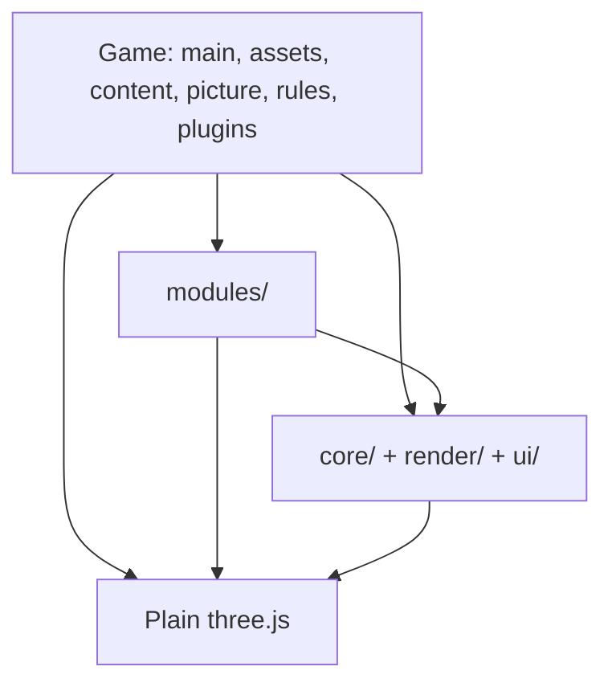
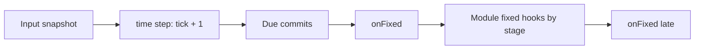
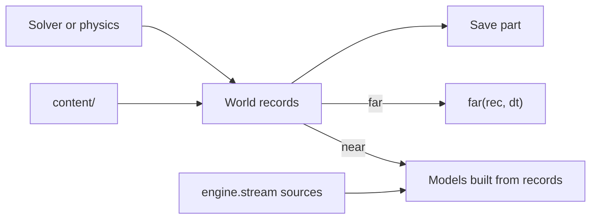
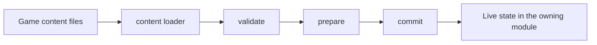

# threedog architecture

This file says what the engine is made of and where each thing lives: boundaries, who owns what, how data moves, and the job of every module directory. It is for AI agents and contributors working on the engine. Games read [AI.md](../packages/engine/docs/AI.md) instead.

One fact, one place:

| Question | Where it lives |
|---|---|
| Why it is built this way | [design.md](design.md) |
| Exact API names and options | [API.md](../packages/engine/docs/API.md) and the generated `api/` pages |
| Every file, one line each | [CODEMAP.md](../packages/engine/docs/CODEMAP.md) (generated) |
| Plain three.js against the engine, line by line | [THREE.md](../packages/engine/docs/THREE.md) |
| Which entry to use for a customization | [CONVENTIONS.md](../packages/engine/docs/CONVENTIONS.md), "Customization ladder" |
| How contributors work | [CLAUDE.md](../CLAUDE.md) and `.claude/rules/` (the maintainer's own `workflow.md` is not in the public repository) |

Paths below are relative to `packages/engine/` unless they start with `packages/` or `docs/`. Each source file's header carries the detail; this page says where to look and what must hold.

**Tests.** Names under "Tests" are filters for `threedog test "<name>"`, which match test names, not file names. Specs live in `tests/specs/`, tools tests in `packages/tools/tests/`.

## 1. Packages

| Package | Job | Depends on |
|---|---|---|
| `packages/engine/` (`threedog`) | Core, modules, render, UI, docs, types. Ships no art | three.js |
| `packages/tools/` (`@threedog/tools`) | CLI, rules, generators, dev server bridge, editor, templates | The engine, through Node resolution |
| `packages/terrain-noise/` | Optional terrain generator | Nothing in core |
| `packages/post-effects/` | Optional post effects | Used through `engine.post.add` |
| `packages/starter-pictures/` | Example picture modules a game can start from | The public engine API |

No package imports another by relative path (R24). `packages/tools/paths.mjs` is the one source of paths.

## 2. Layers

`core/`, `render/` and `ui/` depend on each other as one layer: core imports render and ui, they import core back, and many core files import three. Those folders are for finding things and are not boundaries.

The line that is kept is between that layer and `modules/`: core never imports or names a module (`CLAUDE.md` hard rule 2, R27). Modules reach each other only through public API and events (R25, R46). A module's optional neighbours are read as `engine.xxx?.` and listed in `optional`.

`core/` is sorted by what a file does:

| Folder | Holds |
|---|---|
| `core/base/` | Errors and codes, validation, `readParams`, events, i18n, random, vars, content sections, small helpers |
| `core/engine/` | The `Engine` class, loop, startup, lifecycle, module install and slots, module types, plugins, page, loading, service construction |
| `core/time/` | Time source, clock, skip |
| `core/input/` | Input, contexts, default bindings, pad, pointer, touch |
| `core/saves/` | Saves, save application, versions, storage, the playthrough (`session.js`), the state transaction (`stateReplace.js`) |
| `core/assets/` | Asset manifest, loading, leases, LOD, baking, animator, named models |
| `core/audio/` | Buses, voices, audio rules |
| `core/ops/` | Actions, shared points, owned values, control, holds, actor, wrappers |
| `core/stream/` | Spatial streaming, cells, batching, scatter |
| `core/threads/` | Workers, jobs, commits |
| `core/scene/` | Things, rays, ground, camera, canvas, pixel ratio, plain three.js adoption |
| `core/inspect/` | Describe, inspect, explain, debug views, catalog, checks, budget, picture writers |

## 3. Who owns what

Each row has one owner. Every other entry routes through it. The reasons are in [design.md](design.md), sections 3 and 5.

| Concern | Owner | File | Guarded by |
|---|---|---|---|
| Several parties shape one value | Shared point | `core/ops/sharedPoint.js`, `core/ops/stacks.js` | `shared points` |
| One implementation of a service | Exclusive slot | `core/engine/moduleSlots.js` | `shared points` |
| A value the engine writes by itself | Owned value, yields to a direct write | `core/ops/owned.js` | `owned` |
| Who steers a character | Character control | `core/ops/control.js` | `character control` |
| How a character moves | `character.mover` rule and mover contract | `modules/characters/movers/` | Tools test `contracts` |
| What a key means now | Input context stack | `core/input/inputContext.js` | `input owners` |
| What time it is | One counter | `core/time/time.js` | `TIME` |
| Who may install what, and in what order | Module plan | `core/engine/modules.js`, `moduleSlots.js`, `moduleTypes.js` | `module types`, `module boundaries` |
| How high the ground is | The holder of the `ground` slot | `core/scene/ground.js`, `ground.contract.js` | Tools test `contracts` |
| Replacing the game state | State transaction | `core/saves/stateReplace.js` | `Save failure` |
| Data turning into live state | Content section | `core/base/sections.js` | Tools test file `content-sections.mjs`, `state turn` |
| Discrete actions | `engine.ops` | `core/ops/Ops.js` | `ops` |
| Asset data lifetime | Leases | `core/assets/assetEntry.js`, `Assets.js` | `Audio` for sounds, `Lifecycle` |
| Pixel ratio | One owner | `core/scene/pixelRatio.js` | `pixel ratio: one owner` |
| Post effects | `engine.post.add` | `render/PostFX.js` | `one post entry` |
| Changes the engine makes to three.js | `notePatch` table | `core/scene/threePatches.js` | `Sweep` |
| Shader code | Named patches | `render/patches.js`, `render/slots.js` | R26, R49 |
| Art | The game | `picture/`, `assets.js` | `ships no art`, `no style option` |

## 4. Lifecycle

**Engine phase.** `engine.phase` runs `constructed -> starting -> loading -> ready -> running -> disposed`. It is the one "may this run yet" state. No fixed step runs before `ready` (`core/engine/loop.js`), so game time starts at the same place on every machine. `engine.ready` is true in `ready` and `running`.

**Module state.** `registered -> initializing -> running | failed`, plus `blocked` and `disposed` (`core/engine/modules.js`). Hooks run only for `running` modules. A module whose required provider is not running is `blocked`; it starts by itself when the provider comes up, and `engine.catalog(name).blockedBy` says on what. `critical: true` makes a failed `init` stop `start()`.

**The `ctx`.** Everything a module adds goes through the `ctx` given to `install(e, ctx)` and `init(e, ctx)`, built in `modules.js`:

| Member | What it does |
|---|---|
| `name`, `signal` | The module's name. An abort signal that fires when this install ends |
| `track(handle)` | The handle leaves with the module |
| `mod(point, o)` | `engine.mod` owned by the module, removed with it |
| `feeds(capability, fn)` | This module puts data into whoever holds that capability. `fn` runs before the `use` of a new holder returns, and leaves with this module (section 8.2) |
| `borrow(obj, values)` | Writes values on an object the module does not own. Restores each only if it is still what the borrow left there. One holder per property; a second is refused and pointed at `engine.mod` |
| `rule(name, default, names?)` | A replaceable rule (section 8.4) |
| `input`, `control` | Input declarations, control holds |
| `ops`, `saves`, `ui`, `stream`, `budget`, `things`, `ground` | The registrars. Built-in modules register only through these (`module boundaries`), and `engine.catalog(name).resources` reads them |
| `whileCompiling` | Work to run during shader compilation |

**Teardown.** `_dropTracked` aborts `ctx.signal`, then removes every tracked handle, newest first. One that throws is reported and the rest still go. It runs when an `engine.use` batch rolls back, when `init` fails, on `engine.unuse` or `replaces`, and on `engine.dispose()` before the module's own `dispose`. Modules dispose in reverse install order. `core/engine/lifecycle.js` lists who cleans up what.

**A registration leaves with its module.** `world.present`, `world.simulate`, `rays.addProvider`, `input.touchButton` and `assets.onSwap` take no `ctx`, so a module wraps each in `ctx.track(...)`, or keeps the handle and says where it goes with a `// released:` comment. R65 makes either one an error to skip. A record a kind's presenter drew stays in `world` when the presenter leaves: only its model goes, and the next install of the kind builds it again. Test `Provider swap: every module can leave` takes each module away from a running game in turn.

**Failure tiers** (`core/base/errors.js`). A `picture` or `ui` module that throws from a hook gives back its `ctx.borrow` values, is disabled and reported once, and the game keeps running. Elsewhere, a throw freezes gameplay in dev and tests and is recorded in `engine.error`, and it stays frozen until reload, through a new game too, because an error must not be hidden; a release build reports once and keeps running. Core steps such as rendering report once per site.

**Playthroughs.** Per-playthrough state is a save part. `engine.session.newGame / load / quit` end the old playthrough and apply the captured new-game state (`core/saves/session.js`). State not saved stops on a tracked `session:end` listener, or through `session.track` when a failed load must leave it standing, and derived state is rebuilt on `session:start` or `save:loaded`. A `session:end` listener only stops things: whatever starts for the next state waits until every listener ran (flow enters its start state a microtask later), so install order decides nothing. What is taken during play and not saved ends with the playthrough: script, cutscene and physics holds on `engine.control`, `world.anchor` (back to what boot left), function timers. A module's function timer follows the module: tracked during install it comes back at each new playthrough, gone with the module it stays gone. A part or a player that joins after `start()` joins the new-game state: a late part as its `init` left it, a late player where it began, a late pack's `startItems` given again. `audio.state` and the level are save parts; the opening scene saves as a mark, so a new game goes back to it.

**One list around a replacement.** Every door runs the same steps, and the top of `session.js` is that list. A save put back fires `save:loaded`, with `(data)` for `saves.apply`, and closes the title. A rollback fires `session:failed`, with `kind: 'quick'` from `saves.load` and `saves.apply`, and what a `session:end` or a `world:load` took down comes back on it. After a quit no playthrough runs until a new one starts, so `session.playing` is false with or without a title part and autosave cannot write the blank state over a save.

Code that waits and then writes game state (`stream.teleport`, `engine.skip`, `flow.transition`) takes `saves.generation` when asked and writes only if it is unchanged. It moves with every replacement, `saves.load` included, a failed load gives it back, and a level change leaves it. `session.id` misses a quick load and `commits.epoch` moves for a level too. `save:loaded` fires for `saves.load` and `saves.apply`, so what `session:end` stops in a new game stops on it in a quick load.

Tests: `Lifecycle`, `Session`, `Save failure`, `durability`, `[guard] session`, `[guard] order`, `[guard] teleport`, `[guard] flow: a transition`, `[guard] skip: a quick`.

## 5. One frame and one fixed step

Each frame, `core/engine/loop.js` turns real time into up to a bounded number of fixed steps, then runs the frame work and draws. A long hitch slows the game for that frame instead of replaying it.

Fixed steps run at 60 per second (`STEP`, `core/time/time.js`). Then the frame runs `onFrame` callbacks, module `frame` hooks, stream, jobs, the draw, and `afterRender` hooks.

Hooks order by stage first (`control -> ground -> environment -> gameplay -> effects -> late -> audio`), then by `before` / `after` inside a stage, then by install order. `late` is the default, so characters and rigid bodies run after `gameplay` hooks unless they say otherwise. A `before` / `after` that contradicts the stages, or forms a cycle, makes `use()` throw naming the modules.

A frozen engine runs no fixed step: `onFixed`, module `fixed`, tick and every time view but `ambient` stop, while frame hooks, stream, jobs and the draw continue.

## 6. Shared points

The rules and the layer table are in `core/ops/sharedPoint.js`; the registry `engine.stacks`, the `for` timers, save and `describe().shared` are in `core/ops/stacks.js`.

- Layers, lowest first: `engine < game < effect < system < settings < debug`.
- Inside a layer: `set`, then every `add`, then every `mul`, then every `clamp`. A higher layer's `set` hides everything below.
- Settings only restricts: `clamp: { max }`, `mul` from 0 to 1, or `set: false`. A point opts out with `settingsSet` where the player's choice is a replacement, as in key bindings.
- One entry per owner per point. The same owner writing again replaces its entry.
- Two different owners that `set` one point on one layer throw `shared-conflict` in every build, and the first value stays.
- Kinds: `number`, `value`, `any` (true while anyone holds it), `top` (latest holder), `one` (exclusive slot).
- A read recomputes from the base and the entries still there. A point writes no three.js by itself.
- Entries on layers below settings are saved.

Holds are points too (`core/ops/holds.js`): pause, freeze and the camera. The first camera holder records the view it took, and the last one out lands it (`viewHold` in `core/scene/view.js`, the only writer of `camera.fov`, R66): a rig or the slider changes that record during a hold, a shot shows its fov through `holdFov`. Test: `rig writes during a hold`. The quality tier is a point as well: `engine.tier` reads `'tier'`, the device's value with the player's preset set over it. Picture systems meet on points such as `post.<name>.enabled`, `shadows.enabled`, `sky.tint`, `sky.flash` and `ground.cover`.

Tests: `shared points`, `shared points in a running game`, `owned`.

## 7. Time, input and control

**Time.** `core/time/time.js` is the only file that adds to any time. `engine.time.tick` counts fixed steps. Everything else is a read-only view: `time.now('real')`, `'ambient'`, a channel name, and `'calendar'`. Channel speeds change only through `engine.mod('time.<channel>', ...)`. Timers are one queue (`engine.clock.after / every`). Three entries move all views together: a fixed step, `engine.skip`, a new playthrough. Late work reads these counters and never multiplies by today's speed: `world.simulate` keeps per record the channel reading of its last settlement (a `time.local` rate moves it as steps pass), so a far `dt` is what the record lived through, and that reading is saved beside the seconds owed (`modules/world/sim.js`). Tests: `TIME`, `Channel debt`.

**Skip** (`core/time/skip.js`). A long skip advances in segments that end at each timed thing. Module `fixed` hooks, `onFixed`, physics and near simulation do not run; a module with its own time implements `skip(dt, e, done)`, or sets `noSkip` to say why it has none. Each module declares how it advances in `skipKind` (section 14.2). Far world records catch up once at the end.

**Input** (`core/input/`). Contexts form a stack with base `walk`. The top context shadows lower ones bound to the same key, and is opaque by default. Menus, dialogue and cutscenes push a context with an `owner`. A switch applies at the start of the next fixed step. Modules only declare actions (`ctx.input.define`); the game binds keys. Bindings are the shared point `input.keys`. Only `inputDefaults.js` and `presets.js` may name a key. Test: `input owners`.

**Control** (`core/ops/control.js`). One control slot per character id, with layers `base < script < cutscene < net`. The highest holder is in charge and lower ones are paused, not cancelled. One owner per layer: a second one throws `control-conflict` in every build, and the first keeps the layer. A direct `character.move()` from anyone else throws `control-bypass` in dev. Holds are not saved. Test: `character control`.

**Tasks.** A walk is a task on the slot: a hold with a `task(why)`. `TASK_ENDS` in `core/ops/control.js` is the one list of what ends a task (state replaced, level change, placement, seat, physics taking the body, the character going, a newer order). A task subscribes to nothing itself: `endTasks` is called by whoever owns the change, and a pause under a higher holder is no ending. An NPC's path is the same: a task on its base hold, dropped by a placement through any door. Test: `walk ends`.

**Riding.** A seat is one relation `{ rider, vehicle, id, seat }` owned by `modules/characters/seat.js`, not a side effect of `move()`. Its own fixed step, after the holders, keeps the rider on the seat with or without a holder and lets go of the pedal when the keys are no longer in charge. The record keeps the vehicle id and the seat. A record finds its vehicle through one registry: rigid joins its cars, `characters.addVehicle` joins a game's own, and a vehicle joining late seats the rider its record names. Tests: `seat book`, `seat source`, `rider left`, `stale throttle`.

### 7.1 Seats

Several local players on one screen. A seat is routing and not a second input system (`core/input/inputSeat.js`).

`engine.input.seat({ pad, keys })` returns an object that reads like `engine.input` (`down`, `pressed`, `released`, `axis`), through the same contexts, gates and fixed-step snapshot. It hears its own keys and its own pad, nothing else, on any engine of the page: only pads no seat is bound to follow the input owner. Seats of two engines may bind one pad, and both hear it. The game's pad bindings apply to that pad, and the pad leaves `engine.input` until `seat.remove()`. Two seats on one pad or key throw `input-seat`.

`addPlayer({ id, input: seat })` (`modules/characters/player.js`) adds a character with its own world record of kind `player`. One seat drives one player, and `characters.moveInput(seat)` reads a seat from a control function. `engine.player` is the first player, or the one created without an `id`; when it goes, the next player takes the name. The record is saved and the seat is not, so the game makes its seats again after a load.

Limits:

- One context stack serves every seat, so a menu that takes the keys takes them from all seats.
- A seat has no look input, because a shared screen has one camera. Split screen is not supported (section 17).
- `engine.actor` names who `engine.input` acts for, and `seat.actor` who a seat acts for (set by `addPlayer`). Interactions run each seat's press, hold, facing and approach as its actor. The prompt stays `engine.actor`'s, since there is one screen, and one hold runs at a time. Markers, auto pickups and a trigger with no `who` measure from `engine.actor`. A trigger's `who` can list other players by record id.
- These follow `engine.player` only: the `vehicle` input context, the camera on entering and leaving a vehicle, the touch jump button, and the stream source `engine.stream.player`. Footsteps and NPCs giving way cover every player.

Tests: `L1 seats`, `apartment seats`.

## 8. Modules

### 8.1 Types and stages

`core/engine/moduleTypes.js` holds seven types with no subtypes: `world` (state, draws nothing), `picture`, `actor`, `rules`, `ui`, `net`, `tool`. Every module declares one (R47). The type says what the module may own and how its errors are handled. `stage` only orders hooks. Dev checks at the common write points refuse a mismatch, such as a picture module defining an op or a ui module binding a key.

Terrain, vegetation and weather are each split into a `world` module and a `picture` module, so that replaced drawing keeps collision, navigation and saves.

### 8.2 Slots, contracts and the change plan

A module declares `provides: ['inventory']` and `requires: ['inventory']`, naming the slot and not a module. `engine.use(mine(), { replaces: 'inventory' })` unloads the holder first and puts it back if the new install fails: it cannot wait, since both would claim the slot, the save key and `engine.<name>`. The module installs fresh in its old place and takes its save data back. A swap that works fresh-installs the newcomer the same way, so `module:restored` fires after both, with the fresh modules, once their init is done: content sections load again. **A change is finished when queries can trust it.** A module that feeds a provider says so with `ctx.feeds('collision', fn)`, and the plan runs each feeder of a new holder at the end of `_applyChange`, inside the install's `try`: the line after `use` reads the level walls, frozen or not, and a provider that refuses them fails that `use` and the old one comes back. So no feeder keeps a hook that happens to run, and `module:restored` stays for what must wait for `init` (content sections). Content feeds its built solids the same way, to `collision` and `collider3d`. A slot is a kind-`one` shared point, so `describe().shared` shows holders beside values, and a provided name is aliased onto the engine (`engine.collider3d`, `engine.picture`).

**A handle belongs to the object that issued it.** A body, an agent, an interaction entry or a mirror lives in one provider instance, and a new instance has none of it. So a consumer keeps the issuer beside the handle and compares that object with the one installed now: a body its holder (`content/templates.js`), a Rapier mover the `world`, an NPC agent the `crowd`, a prop, NPC, pickup or car its `interactions` module, a rig the player it follows. A version number never decides this: `version` and `revision` count per instance, so a new module can match the old one; `pathAsync.js` compares them only after resetting on another provider. A provider is read where it is used, never kept in a field. What lives inside a provider goes with it: `rigid` exits the riders of its vehicles when it leaves, since only the owner knows. Tests: `Provider swap` swaps every slot under a running game and scans the sources (a new slot needs a row), `Provider caches`. **Foundation slots** (`FOUNDATION_SLOTS` in `moduleSlots.js`) are the slots a running game cannot swap, and `world` is the only one, because it owns every record: `replaces: 'world'` is refused with `module-replaces` and `unuse('world')` with `module-unuse`, in `_planChange` before anything changes, once a module names it in `requires` or `optional` or the game has started. Before that it works like any slot, so a project chooses its own foundation at install.

`use`, `unuse`, `replaces` and plugin on / off all go through `_planChange` in `moduleSlots.js`, which works out the module graph after the change and checks every consumer before anything is touched. Install is all-or-nothing per `engine.use(...)` call.

**A swap is more than the slot.** A factory's sibling goes with its holder: `_replaced` also unloads a module listed again by name that requires one that leaves, so `terrain()` swaps `terrain` and `terrainDraw` together. A sibling not listed stays on the holder that went: a game that swaps in its own terrain names `terrain-draw` as well. What the old install holds outside `ctx` is its `dispose`'s to give back: a rig's camera hold, a live ragdoll. A level comes back through its save part, and the section's `once` then keeps a pack's older level out of the replay.

A replaceable capability has a contract file listing its API and fields: `modules/*/contract.js`, `*.contract.js`, and `core/scene/ground.contract.js`. What a provider of `characters` hands out is an object contract of its own, `characters/character.contract.js`: the members world and rigid ask of a live character, and `engine.control.resolveWith`, the provider's one way to answer `control.characterOf`. The characters, mover and vehicle contracts also state `position`: the authority and who may write a character's position. `@threedog/tools/contract` runs the same check on the engine's module and on a replacement. R50 limits engine code outside a module to the members a contract lists, through a local too, and follows a live character from `engine.player` and `characterOf`, so a replacement that passes cannot crash on an unlisted call.

**A copy of another owner's data syncs on read.** `core/base/follows.js` compares owner, then version, and only a rebuild that returned counts: one that throws is built again by the next read. Rigid's walls, level triangles and default floor (it exists only while the ground has no collision of its own), nav's obstacles, a level's walls and ground chunks go through it. Queries and steps both ask, so a frozen engine answers from the present: `collider3d` and rays bring in what changed, and since the installed Rapier refreshes its query structures only in a step, they run two steps of no time when something did, in one place (`modules/rigid/refresh.js`; tools test `rapier refresh` checks add, move, remove with a reused collider and a kinematic body, and that velocities, sleep, contacts and a pending kinematic move stay). A level's walls are the one copy whose reader is another module, so no read passes through the level: their boundary is the change of holder (`ctx.feeds` above) and the level load. Tests: `refresh`, `Provider complete`, tools test `follows:`.

Tests: `module types`, `module boundaries`, `rules`, `Provider swap`, `swap`, tools test `contracts`.

### 8.3 Capability order and readiness

`requires`, `before`, `after`, `has` and `usable` read a name one way (`giversOf` in `moduleSlots.js`): the module of that name, or whichever module provides that capability now. So an order survives a `replaces`. `before` and `after` ignore names that are not installed and order modules only inside a stage. An order that contradicts the stages is refused with `module-order` before anything moves, whether it names a module or a capability, so a `replaces` cannot turn a stated order into a suggestion. A module that only wants a neighbour's value a frame sooner states no order.

| Call | Says |
|---|---|
| `engine.has(name)` | A module of that name or a provider of that capability is installed |
| `engine.explain({ module })` | It runs, and if not, why (the internal `engine.usable(name)` is the same answer as a boolean) |

A capability's shape is checked where it binds. `index.js` fills `CAP_CONTRACTS` with the contracts of the capabilities, because core imports no module. After a module change, a dev build compares each running provider's API with its contract, by name, and calls nothing. A gap warns once with `module-contract`, and `engine.catalog(name).problems` lists it in any build. It does not refuse the module. `ground`, `mover` and `vehicle` have contracts but are not on the list. Behavior is checked only by `@threedog/tools/contract`. The reasons are in [design.md](design.md), section 7.2.

Tests: `Readiness`, tools test `contracts`.

### 8.4 Rules

A replaceable rule is a plain shared point with `kind: 'value'` and `per: 'optional'`, read through the internal `ctx.rule` (`Stacks.rule` in `core/ops/stacks.js`); the design is in [design.md](design.md), section 7.4. Rules are not saved: whoever set one still holds it after a load.

| Rule | Default | Read by |
|---|---|---|
| `fall` | `false`, no rescue; `'rescue'` is the built-in a game or a walking preset chooses | `modules/rigid/RigidBodies.js`, `modules/characters/movers/support.js` |
| `ragdoll.graph` | `'humanoid'`: a physics helper default, other body plans set their own graph | `modules/rigid/ragdoll.js` |
| `character.mover` | The character's own mover | `modules/characters/Character.js` |
| `characters.path` | `'walk'` | `modules/characters/pathAsync.js` |

Choices that belong to one call stay options: `occupancy` on `triggers.add`, `bubbleChoice` on `dialogue()`, a quest step's `next`.

## 9. Space

**Ground.** `core/scene/ground.js` holds the queries; the `ground` slot holds the provider. `flatGround` answers when nobody does. `terrain` and `level` each hold the slot and refuse each other. `compositeGround({ parts })` (`core/scene/compositeGround.js`) holds it instead, over modules installed with `{ part: true }`, and answers from the part whose region contains the point. A provider passes `core/scene/ground.contract.js`. `describe().spatial` says who holds the ground, the void height and the water under the player.

**Walking collision.** `modules/collision/` keeps circles and rotated rectangles for upright characters and camera blocking. It works on the ground plane, with a height.

**Three-axis collision.** `modules/rigid/collider3d.contract.js` lists `addSolid`, `overlap` and `sweep`. `rigid` is the first holder. Tilted solids need a holder: content refuses a tilted `collide` without one by name.

**Paths.** `engine.characters.findPath` asks the rule `characters.path` first, then the navmesh when `nav` is installed and ready, else A* (`modules/characters/astar.js`). The rule is how a game supplies paths through open space. The engine ships no volumetric navigation.

**Physics pose.** Rapier works in world space. `RigidBodies.js` writes back through the parent's transform, and a parent whose world scale differs between axes is refused by name. A body owns its pose and a world record follows it, so one route decides a template body's place: its id is the record id, its state in the save part `rigid` wins over the record, and `atRest` (set by `content/templates.js`) keeps a copy nothing moved out of both.

**Water.** `engine.waterAt(x, z, refY)` reads the provider's `water`, else `waterLevel`, plus bodies. `addWaterBody({ query, bounds, mesh })` adds a body whose level comes from the game's `query`; the game draws its mesh and `modules/water/Water.js` skips it. Triggers and water bodies both accept the plain volume `{ contains(p), bounds }`.

**Placement.** Content takes `rot` and `scale` as `[x, y, z]`, and `ground: false` keeps the written height (`modules/content/models.js`).

### 9.1 Multi-floor

A height travels with a position, and a reference height picks the floor. Two heights count as one floor when a body standing at one would reach the other (`sameFloor` in `core/scene/floor.js`, the one tolerance). The reasons are in [design.md](design.md), section 8.2.

| Part | What it does with height | Limit |
|---|---|---|
| Ground queries | `surface`, `slope`, `groundType` and `waterAt` take `refY`. `level`'s heightfield picks the highest layer not above `refY` plus one step; without `refY`, the top layer (`modules/level/heightfield.js`) | `terrain` has one layer, so `refY` picks nothing there |
| `compositeGround` | Passes `refY` to the part that answers | A region is (x, z) only and ignores height, so one part answers for every height at a point. Storeys are layers inside a part, never regions |
| Content | `floor` is a reference height, and a level marker lends its own. The record keeps it, so a moved thing lands on the same storey | |
| Paths on `nav` | `nav.point` is the one rule. A height picks the nearest mesh surface at that spot, and no height means the top ground. A height on no floor warns `nav-height` and uses that surface | Floors join only where the mesh joins them, by a walkable ramp or stairs, or through `nav({ links })` |
| Paths on A* | Height rides from cell to cell, and every returned point has a height | A search node is a cell and a floor, so A* follows a slope to another floor and passes under what it later climbs onto. A goal on a floor no walk reaches is `noPath`, and a goal with no height counts on any floor. Stairs steeper than a step per cell, ladders and jumps use `nav` or the rule `characters.path` |
| `findPathAsync` on A* | The worker's ground raster holds every floor of a cell, read off `surface(x, z, refY)`, and picks one by the heightfield's own rule (`layerUnder`, `core/scene/floor.js`). Boxes go by floor, as on the main thread | 1 m cells: a floor's edge can fall a cell off the live answer |
| `walkTo`, schedule stops | Goals keep Y, and arrival checks it (`sameLevel` in `modules/characters/moveHelpers.js`). No Y on a goal means any height | A far NPC moves in (x, z) on the floor it stood on and takes the stop's floor on arrival (`modules/characters/npcSim.js`) |
| Walking collision | A box with `y` stops only a body overlapping its span, in `resolve`, `walkableAt` and A* | A box without `y`, every circle and the ground's own colliders block at any height |
| NPC avoidance | Pushes in (x, z), and only from walkers on the same floor | `nav({ crowd: true })` separates by the mesh instead |
| Interactions | Distance is XYZ from the actor to the object | |
| Triggers | Cylinder, box and sphere are bounded in Y. A `volume` answers for itself | |
| Picking | A three.js ray, so XYZ | |

Tests: `L1 floors`, `apartment`.

## 10. World, streaming and position

`modules/world/` keeps anything the game must remember or change while far away as a plain record with a stable id, kind and position. A model is what gets built while the record is near. Records stay when models unload. The world knows nothing about kinds of game object: the game or a larger module tells them apart by `kind` and writes its own `present` and `simulate`. Record data must be plain values.

`core/stream/` loads around sources. `core/threads/Commits.js` is how a background result that affects gameplay takes effect: at a fixed tick decided at request time, in a stable order, with a main-thread fallback if it is late. Results that only change the look need not go through it.

Who holds an object's position is a design rule ([design.md](design.md), section 9). The characters, mover and vehicle contracts state it (section 8.2); data rows state it in code with `positionFrom` on `world.present`.

## 11. Content, saves and actions

### 11.1 Content

A module owns a section through its `content` field: `{ desc, references, validate, prepare, waitFor, commit, cancel, undo, effects, live }`. A game module needs this only to own a data word of its own, usually just `commit`; the rest is a targeted extension (design.md 2.13). `core/base/sections.js` is the one protocol, and two owners of one section name are an error. `prepare` must not touch the game and may be async; `commit` is the only step that changes state, and may return `DROPPED` when the section gave way to a newer load: that section is skipped and the rest commit (the newest level load wins, a pack is never lost to it), after `waitFor` has held them until that load ended; `cancel` lets go of a prepare that will not commit; `undo` is called just before `commit` and returns what puts that commit back. One `content.load` is one transaction across its packs, with the rules, actions, audio, views and renames inside it: all sections checked, then prepared, then committed in order once nothing is left to wait for. A commit that throws takes back every commit before it; a game kind's `load` is game code and has no undo, so kinds run after the modules' sections. An undo may have to wait (a level that loads again): the transaction fails only when every undo ended, and everything in line and gameplay wait for it. What could not be put back rides on the error (`err.notRestored`). `content.load` returns the Promise of its own transaction. Loading a level is such a section (`modules/level/load.js`): it emits `level:loaded` when state is committed and `level:playable` when every module and required nearby build has settled, or `level:failed` and keeps the old level.

Sections are held by `characters`, `dialogue`, `inventory`, `quests`, `pickups`, `grids`, `level`, `triggers`, `vegetation` and `content` itself.

Design data lives in the game's files with fixed ids. `packages/tools/content-write.mjs` (`threedog content set|add|remove`, `threedog tune`) edits one file by targeted text edit, refuses code-built entries, and rolls back when the check fails. The in-browser editor (`packages/tools/editor/`, dev server only) reaches content through `editor/design.js` and `content-write.mjs` only (R54).

Tests: tools tests in `packages/tools/tests/` whose names start with `content`; `tests/specs/content-transaction.mjs` for the load transaction.

### 11.2 Saves

`core/saves/Saves.js`, `saveApply.js`, `saveVersions.js`, `SaveStore.js`. Parts are checked and migrated before anything changes, and a shape change raises `version` with a `migrate`. A part whose `load()` throws rolls every part back and keeps the old playthrough (`session:failed`).

`core/saves/stateReplace.js` is the one transaction for `saves.apply`, `saves.load` and `session.newGame / load / quit`. Requests run one at a time, in order. `saves.save` waits for every replacement already in line, so a save can never mix two states. The `replacing` marker is what ops read to refuse work during a load.

A call belongs to a replacement only when it says so. A part's `load(data, turn)` and a module's `afterLoad(engine, turn)` get the turn, and `level.load` / `content.load` take it back as `{ turn }`: that call goes at once, before or after any await. A browser has no async context, so nothing else can tell the code after an await from a click, and a marker held across the await would let the click in too. Without a turn, or with one that ended, a request waits in line. A request a load awaits without its turn therefore waits for itself; dev says so when a request stalls in line (`save-nested`). A new replacement asked inside a load starts after it. A part registered during a replacement loads whole, in its own turn, after it.

Tests: `Save failure`, `durability`, `state turn`.

### 11.2.1 Loads and state turns

Rule: one limit, one settle, one turn. Files: `core/assets/assetEntry.js`, `core/engine/Loading.js` (`_limit`), `core/engine/headlessLoad.js` (`whenSettled`), `core/saves/stateReplace.js`. Guards: the `[guard]` rows of `tests/specs/vertical-world.mjs`.

- The caller decides what a failed file means. An entry says what it can fall back to; `assets.wholeModel` (internal, used by level) refuses a stand-in and tries the file again.
- A load with no sign of life for `engine.loading.timeoutMs` fails by the normal path, so no wait above it needs a timer. Do not add a timeout to a save or a transaction: it would roll back around a load still running. A waiter with a signal may leave, and a load with no waiter left is aborted.
- `whenSettled` is the only wait for "ready to play", it has the same limit and it can fail. `stream.teleport` keeps its own frame-time limit.
- A replacement holds the turn. `level.load` and a pack's commit go behind it through `whenTurnFree`, at once from inside a part's load. They do not take the turn: two doors in a row still overtake each other.
- `stateTurn` marks a change of several steps (door trip, cutscene). Only autosave waits for it, and core does not know who holds it.
- `state:replaced { undone }` (internal) fires last, once per job that changed the state, and at start and for a scenario. Derived state listens to it alone. `save:loaded`, `session:*` and `state:applied` keep their public meaning.

### 11.3 Actions

`core/ops/Ops.js` (with `opsRun`, `opsCheck`, `opsGuard`, `opsHistory`, `opsAtomic`, `opsFail`). `engine.ops.define / run` is one discrete player or NPC action, checked by `can` and logged with tick, source and actor. An op's `ctx` carries `source`, `actor`, `tick`, `frozen` and `session` (the playthrough, `engine.session.id`); a nested op inherits source, actor and session. `ops.guard` warns in dev when saved gameplay state is written outside fixed steps and ops. Continuous input and simulation are not ops.

An op can change any save part, so every engine part answers for it: `atomic: true`, or `notAtomic: '<why>'` (rule R67). Rollback loads the atomic parts back synchronously (an async `load()` is refused there), so what they hold is plain data.

Tests: `ops`, `atomic once`, `rule R67`.

## 12. The picture

**Plain three.js.** The game's `picture/` folder writes three.js and reads `engine.uniforms`. The engine has no second picture language: a module's look is a three.js material on the module (`engine.water.material`), and what the engine computes (sun, daylight, wind, cloud shadow) is a signal in `engine.uniforms`. Entries exist only for what three.js has no line for: `render/shadows.js`, `core/scene/view.js`, `render/terms.js`, `render/PostFX.js`.

**Adoption.** `core/scene/sceneDelta.js` makes `scene.add` at any depth equal `engine.add`. `core/scene/gameLights.js` counts plain lights in the budget. `core/engine/plugins.js` and `packages/tools/vite/` plug in the game's `plugins/` folder by what each file exports. `render/ownFrame.js` lets a game take the whole frame. Every change the engine makes to three.js itself is registered with `notePatch` in `core/scene/threePatches.js` and listed in `describe().threePatches`.

**Picture modules.** A style pack is a `picture` module with `provides: ['picture', ...]`, built only through `ctx`, and switched with `engine.use(next(), { replaces: 'picture' })`. `packages/starter-pictures/` holds two. `core/scene/pictureSlots.js` is the one table of picture slot names (`sky`, `fog`, `tone`, `environment`, `background`, `sun`). A game mesh holding an old pack's material must rebind it.

**Picture writers** (`core/inspect/pictureWriters.js`). On the dev server it records which `file:line` last wrote each picture value, and reports `picture-conflict`, `picture-held` and `picture-leftover`. It reports and never blocks, and it is not in bundles or release builds. R48 checks that engine code does not write these values.

**Backends.** `render/backend.js` holds renderer facts that differ; `render/vertexInputs.js` counts each WebGPU program's vertex inputs before its code is written and names what stacked up over the device limit (guard: `tests/specs/vertex-inputs.mjs`). `core/engine/startup.js` chooses WebGL or WebGPU at start, and the choice never switches. `render/fx/` holds the engine's shaders as TSL, published as `threedog/tsl`. `render/slots.js` is the table of semantic patch slots. `render/fxNumbers.js` holds numbers shared by GLSL and TSL. Shader code enters only as named patches (R26), and each has both forms (R49).

**Pixel ratio.** `core/scene/pixelRatio.js` takes every engine write. `pixelSize` is a mode of it, and while on, the others are held off or refused (`pixel-conflict`).

Tests: `no style option`, `no makeMaterial`, `ships no art`, `one post entry`, `sky entries`, `picture writers`, `picture parts`, `pixel ratio: one owner`, `pixelSize`, `plain three.js adoption`, `plugins folder`, `renderer backend`, `shader errors on WebGPU`.

## 13. Assets

`core/assets/` registers every model, texture and sound under a name, and code uses names only. One name loads once (two names for one file load it twice; a part `{ url, node }` and a path share the file's entry). A model copy shares geometry and materials. One lease count covers everything: a model copy is a lease (internal: games keep the copy, only engine modules such as content take one directly), `release(name)` frees only after the last lease ends, and `trim()` frees models with no copy in use. `describe().assets` lists leases and names waiting to be freed. A file that fails falls back to a gray placeholder, silence or the entry's fallback.

Every model copy that reaches the game or the scene leaves through `Assets.handOut`, which runs the game's `onModel` setup once; prototypes and LOD levels are bare copies (`_bare`). A manifest `{ url, node }` entry (`assetPart.js`) is one node of the file's own path entry and holds a lease on it. Test: `[guard] model setup: every clone handed to the game goes through handOut`.

## 14. Seeing and checking

`core/inspect/` answers questions without the game's cooperation:

| Entry | File | Answers |
|---|---|---|
| `engine.describe()` | `Describe.js`, `describeText.js`, `describeRender.js` | JSON-able current state. Every module has `describe` (R44) |
| `engine.catalog(name)` | `catalog.js` | What is installed: hooks, resources, `blockedBy`, skip kind, `problems` |
| `engine.inspect(...)` | `Inspect.js` | What is around someone and what they can do |
| `engine.explain({ ... })` | `Inspect.js` | The one way to ask why: `op` (can it run), `value` (who wrote it), `thing` (where an id comes from), `module` and `capability` (does it run, what blocks it), or any key a module answers through `explain` |

Errors carry a code, the broken rule and a pasteable fix (`core/base/errorHints.js`, `errorCodes.js`). `readParams` in `core/base/params.js` throws on an unknown option.

A release build warns once where the engine can carry on, and a shared point or control conflict throws there too ([design.md](design.md), sections 2.4 and 5.3).

### 14.1 Write tracking

Each kind of value has one observer. All of them report, and none of them blocks a write.

| Values | Observer | What it gives | Where it runs |
|---|---|---|---|
| Saved gameplay state | `ops.guard(where)`, called at the top of a method that writes it (`core/ops/opsGuard.js`) | `ops-guard`, once per call site, for a write outside a fixed step, an op or an `allow` window | Dev; a no-op in a production build |
| Picture values, owned values, values named with `engine.debug.watch` | `pictureWriters.js`, `valueHistory.js` | `file:line`, frame, a short history, and a hint when two places fight | Dev server only, and sampled |
| Shared points | The point itself: each entry keeps its owner | `describe().shared`, and `engine.explain({ value })` on the dev server | Everywhere |

`engine.explain({ value })` reads the second and third rows. A value nobody watches answers that it is not tracked. In a release build the tracker is absent, so the same call answers that no writers are known and `engine.debug.watch` returns `watching: false`. A write that changes nothing is not seen, and no answer proves two writers do not exist ([design.md](design.md), section 4.6).

### 14.2 Metadata

`packages/tools/metadata.mjs` reads what the code already declares (module definitions, `params`, content sections, contracts, placement fields, input actions, the api pages) and writes `core/inspect/metadata.generated.js`, published as `threedog/metadata`. It is a step of `npm run map`, `check` fails on a stale file, and nobody writes it by hand.

| Reads it | For |
|---|---|
| `threedog how`, `threedog catalog` | Modules and options with no page running |
| `packages/tools/codemap.mjs`, `apidoc.mjs` | Modules, actions, section text |
| `packages/tools/editor/design.js` | Field labels and sections |
| Rules R6, R38, R50, R51, R57 | What each checks against |
| `modules/content/` | `sectionHomes` and `sectionDocs`, for its errors and field tables |

Two things do not read it. `engine.catalog` reads live registrations, since only a running game knows its own modules and ops. The hand-written `.d.ts` files keep the doc comments, and R6 requires every option and contract name in the metadata to appear in them.

**Skip kind.** `skipKind` is `exact`, `approx`, `step` or `none` ([design.md](design.md), section 14.3). R57 makes it an error for an engine module to leave it out, and `engine.use` refuses an unknown word. A game's module may leave it out; if it has a `fixed` or `skip` hook, `engine.catalog(name).problems` says so. `engine.catalog` shows the kind and the `noSkip` reason under `time`. `engine.checkSkip(seconds)` compares a skip with stepping the same time.

**Reaching the AI that writes a game.** Two checks keep a capability from being rewritten by hand. Before writing: R64 runs a line of the author's own words from `packages/tools/how-tasks.mjs` through `threedog how` for every module, factory, `engine.<group>` and recipe, and the capability must be among the routes listed; a new one fails until it has a line and how finds it. Missed words go to `how-words.mjs` or the "One task, which entry" table. While writing: a system declares the hand-written code it replaces as `export const handRolled` beside its definition, or `'none: why'` when no code shape shows it (R64 refuses a silent module). `metadata.hints` carries the declarations, and R40 only reads them, in this repository and in a project installed from npm. Nothing imports the export, so a game's bundle drops it, and `gentypes.mjs` leaves it out of the declarations. The one module that does not declare is `net`, kept in `metadata.mjs` `FROZEN` while that module is not edited.

Tests: tools test `metadata`, `catalog`, `rule R40`, `rule R64`, `bundle size`, `pack-external`.

### 14.3 Determinism

`engine.step()` and headless loading make jobs ignore the real-time budget and drain the queue, and attach stream builds before returning (`core/engine/loop.js`). The promise and its reasons are in [design.md](design.md), section 14.3. This is what the code does for each part of the scope:

| Scope | What the code does |
|---|---|
| Tick | `engine.time.tick` counts fixed steps, input is a snapshot per step, and the op log carries the tick. The real loop runs as many steps as real time allows, so only `engine.step()` fixes that number |
| Commit order | Background results land at a tick decided at request time, in a stable order, with a main-thread fallback (`Commits.js`) |
| Seed | `createEngine({ seed })`. Left out, headless mode uses 1 and a real-time run uses the current time. The state of `engine.random` is a save part. Presentation code in the engine (sound, particles, ambience) uses `Math.random` and is outside the scope, as is a game's own `Math.random` |
| Content version | Not recorded or compared. Save parts carry their own `version`, but nothing identifies the design content, so a result is only comparable on the same files |
| Platform | Not recorded or compared. The claim stops at one build on one machine |

## 15. Tools

A scenario has two ways to pass time. `step` must run all its seconds, and anything less fails. `until` with `within` stops when the state is reached, so the time an ending takes is not written in the file. Both read `STEPPED` in `pageFns.mjs`, whose `state` tells a freeze, a load and an error apart. `until` runs its 0.1 s slices inside the page (one call per 2 s of real time, not per slice). A run marks the engine, so a page reload (a saved file) makes the next call fail with "the page reloaded during the run" instead of going on over a frozen title. Test: `Scenario until`.

A tool that needs more than the public entries goes through `engine._tools` (`core/inspect/toolDoor.js`): draw while halted, run the frame hooks, hand a halt back, read the frame cost. Nothing else in `packages/tools` touches an engine private (R68).

`packages/tools/rules/R*.mjs` holds one file per rule, with a header `Detection:` saying what it flags and its limits, registered in `rules/index.mjs`. `check.mjs` runs hard rules, rules, the type check, content validation and "generated docs up to date", and ends with one line. `bin/threedog.mjs` leads to `threedog/` (dispatch, commands, dev bridge, mcp). `lib/cli-args.mjs` is the one option parser for page-taking commands.

The test runner finds tests by itself (`packages/tools/lib/specs.mjs`): every `tests/specs/*.mjs` exporting `specs`, and every `packages/tools/tests/*.mjs` exporting `name` and `run`. A spec is `{ name, url, run({ ev, check, page }) }`. A malformed file or a repeated name stops the run before any browser starts. `software: true` forces software rendering, and is implied when `run()` calls a pixel API; `serial: true` runs a spec alone. A filter that matches nothing fails loudly.

## 16. The 30 module directories

"Slots" lists what the directory's modules hold. "Save" is the save part name. Replacing a slot holder is described in section 8.2.

| Directory | Module (type) | Job | Slots | Save |
|---|---|---|---|---|
| `ambience/` | `ambience` (picture) | A rule table of background sounds | | |
| `calendar/` | `calendar` (world) | Days, seasons and calendar timers over the world time channel | `calendar` | `calendar` |
| `camera/` | `cameraRig` (picture) | Follow, first-person, fixed and RTS cameras, one at a time | `cameraRig` | `cameraRig` |
| `characters/` | `characters` (actor) | Player, NPCs, movers, path requests, footsteps, vehicles | `characters` | |
| `collision/` | `collision` (world) | Light walking collision: circles and rotated rectangles | `collision` | |
| `content/` | `content` (rules) | Loads a game's flat data into the sections of installed modules | | `content` |
| `debug/` | `debugPanel` (ui) | Performance panel and time and weather debugging. Dev tool | | |
| `flow/` | `flow` (rules) | Game states and scene transitions | `flow` | |
| `gameplay/` | `inventory`, `quests`, `dialogue`, `interactions`, `pickups` (rules) | Containers and items, quest steps, dialogue, prompts near objects, ground items | `inventory`, `quests`, `dialogue`, `interactions` | `inventory`, `containers`, `quests`, `interactions` |
| `grid/` | `grids` (world) | Placement grids for anything put on cells | | `grids` |
| `hlod/` | `hlod` (picture) | Far buildings as a few proxy meshes | | |
| `hud/` | `hud` (ui) | Objective markers, counters, progress bars | | |
| `level/` | `level` (world) | A hand-built scene made playable: ground, markers, colliders | `level`, `ground` | `level` |
| `lights/` | `lightPool` (picture) | Many light sources on a few real lights | | |
| `music/` | `music` (picture) | Background music | | `music` |
| `nav/` | `nav` (world) | Recast navmesh, generated after a level loads, one per body size asked for (`nav.mesh(radius)`; the worker mirrors the sizes its batches use) | `nav` | |
| `net/` | `net` (net) | Optional host-authoritative co-op sync, no prediction | | |
| `particles/` | `particles` (picture) | One effect is one `THREE.Points` over a ring buffer | `particles` | |
| `photo/` | `photo` (tool) | A sharper one-frame shot, then restore | | |
| `rigid/` | `rigid` (world) | Rapier bodies, ragdolls, vehicles, buoyancy | `rigid`, `collider3d` | `rigid` |
| `settings/` | `settings` (ui) | The settings menu and the settings layer of shared points | | |
| `sky/` | `sky` (picture) | Dome, clouds, fog, environment, season tint | `sky` | |
| `swarm/` | `swarm` (rules) | Many same-kind objects in typed arrays on one `InstancedMesh` | `swarm` | `swarm` |
| `terrain/` | `terrain` (world), `terrainDraw` (picture) | Chunked streamed ground from a height function or map, with edits and workers | `terrain`, `ground`, `terrain-draw` | `terrain` |
| `timeline/` | `timeline` (rules) | Cutscenes, camera moves and scripted movement. A run has one ending (finished, skipped, dropped, failed), said by `play()`, `timeline:end` and describe; what it holds goes back in one `finally` | | |
| `triggers/` | `triggers` (rules) | Zones that report enter, stay and leave | | `triggers` |
| `vegetation/` | `vegetation` (world), `vegetationDraw` (picture) | Species, placement, tree collision and felling; instanced drawing | `vegetation`, `vegetation-draw` | `vegetation` |
| `water/` | `water` (picture) | The global water plane and independent bodies | | |
| `weather/` | `weather` (world), `weatherDraw` (picture) | The game's weather table and signals; drawing | `weather`, `weatherDraw` | `weather` |
| `world/` | `world` (world) | Flat records, near and far simulation, views | `world` | `world` |

## 17. What each level of change can do

Three levels, in the order to try them. A parameter is an option, a rule or a shared point. Replacing a module means a holder that passes the slot's contract. The third column needs a change to an interface the rest of the engine reads, so it means changing the engine. The ladder itself is in [CONVENTIONS.md](../packages/engine/docs/CONVENTIONS.md).

| Area | A parameter can change | Replacing the module changes | Needs a change to the underlying protocol |
|---|---|---|---|
| Ground | Shape, height function, regions and priority through `compositeGround`, layers through `level` | Everything about height, slope, type and void, through `ground.contract.js` | Ground that is not a height over (x, z), such as a sphere: queries assume Y is up, and there is no `up` option. A composite region per storey: regions are (x, z) |
| Walking collision | Solids, radii, heights | The whole walking test, through the `collision` contract | Characters that are not upright cylinders on the plane: use `collider3d` |
| Three-axis collision | Solids, gravity, friction, `fallbackFloor` | The holder of `collider3d`, such as a voxel grid or a BVH | More queries than `addSolid`, `overlap` and `sweep` |
| Paths | Agent radius (the size built at load; other sizes get their own mesh on first ask), `nav({ links })`, the rule `characters.path` | `nav`, or a game's path source | Built-in volumetric navigation: none exists, the game supplies paths. Floor changes on A*: use `nav` or a path source |
| Character motion | Move stats (`move.*`), rule `character.mover`, a custom mover from `mover.contract.js`, `engine.characters.kit` (a targeted extension, design.md 2.13) | All of `characters`, through its contract | The `move(x, z, run, dt, y)` step that control holders feed |
| Falling | Rule `fall`: built-in name, function or `false` | Not needed | |
| Ragdoll | Rule `ragdoll.graph`: a data graph for any skeleton | `rigid` | |
| Water | Level, `flat`, size, the material on the module, `addWaterBody` with a game mesh | The drawing, since `water` holds no slot and height comes from the ground and bodies | Flow simulation and engine splines: not provided |
| Placement | `rot` and `scale` in three axes, `ground: false`, `collide` | `content`'s sections, by owner | |
| Quests | Steps, conditions, `next` as an id or a function, failure | All of it through `quests.contract.js`, and the `quests` section goes with it | Quests per player: the log is one |
| Dialogue | Nodes, conditions, `bubbleChoice` | All of it through `dialogue.contract.js`, with its `dialogues` section | |
| Triggers | Shape, `volume`, `who`, `occupancy` per zone or per entrant | Not a slot: a game writes its own beside it | |
| Inventory | Items, containers | All of it through `inventory.contract.js`, with its section | |
| Camera | Rig options, `engine.mod` holds | The holder of `cameraRig`, through its contract | Several views on one canvas: `engine.camera` is one, so split screen is not supported |
| Sky, weather, vegetation, terrain drawing | Tables and materials on the module | The drawing module alone (`sky`, `weatherDraw`, `vegetation-draw`, `terrain-draw`); state, collision and saves stay | |
| Picture | Any three.js write, `engine.uniforms`, `engine.post.add` | The `picture` holder and picture slots, with `replaces` | The backend after start: it never switches |
| Time | Channel speeds, clock rate | The holder of `calendar`, through its contract | The 60-step tick: `STEP` is one constant that fixed-step code depends on |
| Input | Bindings, contexts, gates, seats | Not a module | Contexts per seat: there is one stack |
| Saves | Parts, versions, `migrate` | Not a module: storage goes through `core/saves/SaveStore.js` | The state transaction: every replacement enters `stateReplace.js` |
| Content | Sections, fields, packs | The owner of a section, and its format goes with it | The `validate`, `prepare`, `commit` order |
| Multiplayer | `net` options, transport | Not a slot | Prediction, anti-cheat and competitive play: `net` is host-authoritative |
