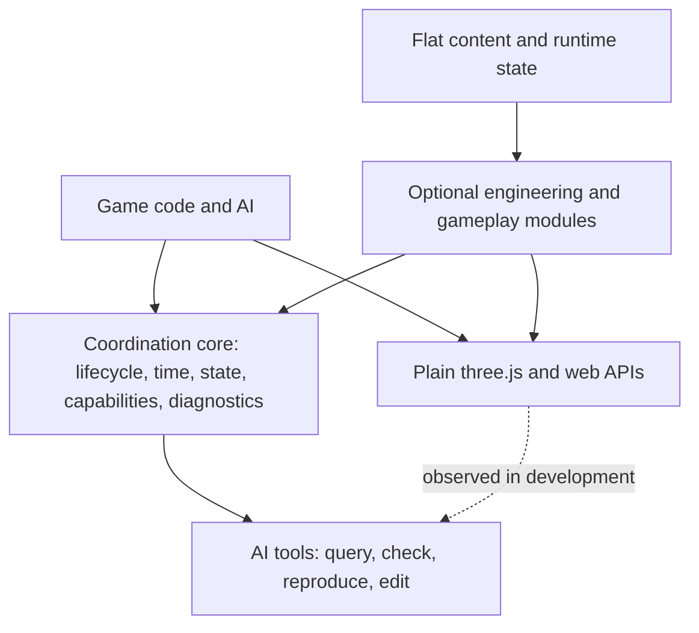

# threedog design

This document explains why the engine is built the way it is. It is the single source for intent and principles.

Other documents own other facts, and this one links to them instead of copying them:

| Question | Where it lives |
|---|---|
| Which file does what, which rule guards it, which test fails if it is bypassed | [architecture.md](architecture.md) |
| How to write a game with the engine | [AI.md](../packages/engine/docs/AI.md) and the [recipes](../packages/engine/docs/recipes/) |
| Exact API names and options | [API.md](../packages/engine/docs/API.md) and the generated `api/` pages |
| How plain three.js meets the engine, line by line | [THREE.md](../packages/engine/docs/THREE.md) |
| Which entry to use for a customization | [CONVENTIONS.md](../packages/engine/docs/CONVENTIONS.md), "Customization ladder" |
| How contributors work on the engine | [CLAUDE.md](../CLAUDE.md) and `.claude/rules/` (the maintainer's own `workflow.md` is not in the public repository) |

When another document disagrees with this one about why something should be so, this one wins. When it disagrees about what exists today, the code wins, and whichever document is wrong gets fixed.

**How to read the status of a statement.** Plain statements describe what the engine does now. A statement that starts with **Decided:** is a settled design that is not built yet. It says what the engine will be, and it must not be read as a promise about the current code. Check the name in the code before relying on it.

---

## 1. The goal

threedog is a base board for web 3D games. Plain three.js, optional engineering modules and a game's own rules live on it together. The AI writes JavaScript and three.js; the engine takes care of what that code handles badly on its own: time, resources, state, dependencies, coordination between systems, and diagnosis.

If three.js is the brush, the engine lets many brushes paint one picture without wiping each other out, and it can say which brush made each stroke.

Two properties define the engine, and every design decision is measured against them.

**It is general.** No gameplay is fixed in it. A slow farming game, a soulslike, a shooter, a survival sandbox, a side-scroller, a flight game, a tactics game and a multi-floor mystery should all be possible without working around the engine. A gameplay rule baked into a module, such as how a fallen body is rescued, what bones a ragdoll has, or how a quest advances, counts as a defect to remove. A documented limit does not settle it.

**It is systematic.** The engine is one system, not a pile of tools. That has a precise meaning:

- Each concern has one owner.
- Each value is decided in one place, and every other entry goes through that place.
- When two things collide, the collision is reported with both names and the fix. Nothing resolves it silently by letting the last write win.
- When two mechanisms collide, the first answer is to delete one of them. A new precedence rule is the last resort.

The primary user is an AI coding agent, and the target is medium and large web 3D games in any genre and art style. Three things are wanted together: fast to build with, a good result, and especially easy for an AI to use correctly on the first try. These are weighed together, and none of them is traded away quietly for the others.

## 2. Principles

Principles here explain why and how to judge. Hard rules exist only for correctness and safety (section 2.10).

### 2.1 three.js stays open

An AI can write plain three.js at any time: lights, materials, shaders, textures, post-processing, render-to-texture, models. It works. The objects the engine hands out are real three.js objects with their native methods, properties, `instanceof` and types. Names follow three.js and web standards (`dispose`, `AbortController`, `renderer.info`). There is no second scene tree, no wrapper class and no description language for looks.

Why: three.js is what an AI already knows well. Every layer between the AI and three.js is something it must learn, can misuse, and may find blocking. Section 4 states exactly what this promise covers and where it stops.

### 2.2 The engine does three kinds of work

1. **Coordination across systems:** time, weather, light signals and frame order working together, and who owns what.
2. **Wheels:** engineering that is tedious, general and easy to get wrong, such as physics, navigation, saves, assets, loading, streaming, large-world shadows and input.
3. **Visibility for AI:** describe, check, explain, errors that give the next step.

A wheel may exist even when three.js could in principle do the job, as long as it does not decide what a game looks or plays like and does not block direct three.js. How one object looks (its model, material, shader, texture) is three.js's job.

### 2.3 Nothing that makes games alike

The test for any feature is one question: **would this make different games look or play more alike?** If yes, the engine does not offer it. The engine ships no art: no default style, default character, default terrain look, no "one-click watercolor", no wood or stone painters. With nothing supplied, the screen shows neutral placeholders and says so.

Why: an AI copies what is nearby. A default look or a default game rule becomes every game's look and rule.

The same applies to defaults that seem harmless. Key bindings, player movement, camera handling, HUD, dialogue boxes, menus and inventory windows are replaceable or removable parts. Default values and option names are not tuned to one genre. A setting that suits one kind of game either becomes a general design or moves out into an example.

### 2.4 Nothing silently wrong

Conflicts, missing dependencies, a shader written for only one backend and mistyped options are reported on the spot. The report names the broken rule and gives a line to copy. A release build does not throw at the player for a mistake the game can survive: it records a warning (section 6.3), and invalid data stays out of the game state (section 11). A call that would let write order decide a value is different: a shared point conflict throws in every build and the first value stays (section 5.3), so what a game saw in development is what it ships.

Tools obey the same rule. `describe`, `ops` and smoke tests must not call an action usable when no player can press it. A tool that is unsure says so.

### 2.5 Few words, one way

One thing has one entry. The vocabulary stays small (`set`, `add`, `mul`, `replaces`, `type`, `requires`, `provides`) and shaped like `Map` and three.js. No `Proxy` magic and no full ECS. JSDoc carries examples to copy.

Why: two entries for one job are two chances to pick the wrong one, and they drift apart. New work plugs into the system that already owns the concern. Before adding anything, ask who owns this now.

### 2.6 What is replaced is deleted

A new way replaces the old one in the same change: code, docs, options, tests, examples. Engine-internal code keeps no compatibility layers. Public names are frozen since 1.0 (docs/plans/done/2026-11-05-api-freeze.md): removing or renaming one is a breaking change that goes in the lock and the changelog. A rename removes the old name in the same change (no deprecated alias; nobody writes the old names), and the CHANGELOG lists it. Names marked unstable may change in a minor version. Breaking changes go in a migration note.

Why: an AI reads both versions and may use either. An old path left in place is a second source of truth.

### 2.7 Not installed means not paid for

A module that is not installed loads no heavy dependency, creates no GPU resource and schedules no per-frame work. A small coordination ledger may exist, but it may not pull a rendering or gameplay module in behind the game's back. Budgets and performance gates are part of the engine, not an afterthought.

### 2.8 Fix in the owning layer

A bug is fixed at its root cause in the layer that owns it, once. Reports from real use are grouped by root cause before anything changes. Case-by-case patches at the call sites are how a system turns into a pile.

### 2.9 Tool output stays short

Tools are read by AI, and long output spends its context. By default a tool gives the conclusion and the next step, one line per problem, and says little when things pass. Detail lives behind `--verbose`, `--json` or another command the AI can run if it needs to.

### 2.10 Rules are for correctness, principles are for looks

- **Rules** can stop a build. They cover API use, save safety, licenses, grid alignment and similar correctness matters.
- **Principles** cover looks. They explain why and how to judge from a screenshot, and they follow the game's own design intent.

Picture work never has a required target number. A number may appear as the value an example happens to use, or to explain a range ("lower is smoother, this example uses..."). Picture tools report facts, parameter names and current values. They give no target and no verdict.

Why: a fixed number pushes every game toward one picture.

### 2.11 Docs and examples stay generic

Examples span several genres and art styles, one line each, in neutral names such as `plot`, `item`, `thing`. Nothing is written as the only way, and no specific game or style pack is recommended. An AI treats a lone example as the standard answer.

### 2.12 The judgment for any new mechanism

Before a mechanism enters the engine, ask:

1. Who owns this concern now? Can it plug into that?
2. Does it solve a composition problem that has actually appeared?
3. Is plain three.js still the shortest path?
4. Would an AI find it and use it correctly the first time?
5. Does it cost anything when unused?
6. Does it work for at least three different kinds of game?
7. Does it have an exit for looks: tune a value, add a piece, replace the whole thing?
8. Would it make games more alike?

If a mechanism only makes the engine's own code tidier while the game takes a longer way round, it stays an internal helper or it stays in the game.

### 2.13 What earns a public name

An API exists only if it solves something several parties must coordinate and native three.js does not handle. API count is not a mark of quality.

| The job | The road |
|---|---|
| Lights, materials, moving objects | Plain three.js |
| Installing or swapping a feature | `engine.use` |
| Several effects on one value | `engine.mod` |
| Validated, recorded actions | `engine.ops` |
| Module cleanup | `ctx.track` |

Resource leases, stale-job checks, commit queues and dependency graphs are internal. Internals may be complex; the outside stays those few roads. A new public name needs a real game proving the existing entries cannot express it. Two entries for one job: pick one, delete the other. Usage counts alone never justify a deletion.

Metadata (`threedog/metadata`, and `threedog/spelling` likewise, are for the tools), the section protocol (`prepare`, `commit`, `cancel`) and custom movers (`characters.kit`) are internal or targeted extensions. They are reached by a task that needs them, not a protocol every AI must learn. When the engine lacks something, plain JS and three.js connected through modules, events, ops, assets and saves is the expected path.

**A picture tool enters the engine only if** it coordinates the camera, resources, several draw stages or modules, or is easy for an AI to get wrong on cleanup, resize, colour space or backend differences; and the game keeps free choice of material, shape, colour and look. Generic algorithms belong in the engine; finished looks belong to the game or an outside asset library.

- Tools return native three.js objects (Material, Texture, BufferGeometry, plain arrays), say what they changed and who disposes, and a long-lived effect returns a removable handle.
- Pure functions are imported on demand, not hung on `engine`, which keeps only what needs time, resources, scheduling or module coordination.
- Quality settings never change gameplay facts.
- Costly features exist only on demand and report their cost.

## 3. The shape of the engine



The arrows do not mean that picture calls pass through the core. A direct `scene.add`, `material.color.set` or `bone.add` is valid. The engine's entries are for when coordination is needed.

| Boundary | Owns | Does not own |
|---|---|---|
| Coordination core | Lifecycle, capability records, resource ownership, time, action scheduling, state transactions, diagnostics | What the sky looks like, how a character dies, which quest structure is best |
| Scene and render access | Adoption of plain objects, resource leases, render scheduling, post, shadow engineering, backend adaptation | A second Material or Mesh API, a forced style, exposure choices |
| World and streaming | Flat records, spatial queries, view build and teardown, chunk readiness, commit timing | Fixed object kinds such as NPC, chest or crop; removing obstacles by quality level |
| Optional modules | Public capabilities: terrain, navigation, physics, sound, characters, inventory and so on | Reading another module's private fields; quietly overriding a shared service |
| Game code | Art, rules, content, key bindings, the choice of modules | Relying on undocumented engine order |
| Tools | Querying, verifying and recording real evidence from the same metadata | A second copy of the rules; calling something playable because an interface exists |

`core/`, `render/` and `ui/` depend on each other as one layer today. The line that is kept is that core never depends on a module. Code is pulled out into a separate service only when it needs browserless tests or separate loading, never to make folders look tidy, and no generic dependency-injection container is introduced for that purpose.

**Layers in a game.** There are three: the tiny core (time, events, input, ops, saves, describe), optional replaceable modules with contracts and hooks, and game rules in the game. A suggested game layout follows, as a statement of responsibilities and not a requirement that every small function get a file:

```text
main.js      choose modules, wire up, start
assets.js    file assets and procedural generators
content/     flat templates, placements, items, text
picture/     plain three.js lights, materials, fog, models, post
rules/       game actions, continuous simulation, death, rescue, win and loss
plugins/     pieces that plug in by themselves, used only when needed
```

**Two exercises that test the boundaries.**

*Rain makes the paving look wet.* `weather` supplies a rain signal. The paving material in `picture/` reads it and changes its roughness, normal or color. If wet paving is also slippery, `rules/` reads the same signal and changes friction. Turning the wet look off, or painting the paving another way, leaves the slippery rule untouched.

*The player turns into a bird.* If only the look changes, swap the model and animation. If flight is needed, swap the movement strategy, the 3D queries and the navigation capability it needs. Inventory, time, saves and action context keep working, and the character does not have to pretend to be grounded.

In both, the look can change without facts drifting, and the play can be unusual while the shared engineering still applies.

## 4. The three.js promise, exactly

This section is deliberately precise, because "three.js stays fully writable" is easy to overclaim.

### 4.1 What the game can write

```js
const mesh = new THREE.Mesh(geometry, material);
engine.scene.add(mesh);
mesh.rotation.y = 0.5;
material.color.set('#8d99ae');
engine.scene.fog = new THREE.FogExp2('#9ba6af', 0.018);
```

None of this needs converting into an engine object, component or data description. `scene.add` at any depth is adopted like `engine.add` (the engine can list it, find it and count it). Adoption is bookkeeping: it does not transfer ownership of the geometry or material (section 6.2).

Plain materials, `ShaderMaterial`, node materials and the game's own post chain work within the chosen backend's abilities. They are not refused for lacking registration.

### 4.2 The engine respects direct writes

The picture's values have one writer, the game's picture code. The engine does not write lights, fog, exposure or environment maps, and it does not write the game's materials' values. Those values have no engine writer to conflict with.

The engine does write a short list of properties on its own: for example the sky's background, the shadow box's center, the view's far plane, the camera a camera module drives, and the pixel ratio. Each is registered in `core/ops/owned.js`, and each follows one rule:

- Before writing, the engine compares the value with what it left there. A different value means someone else wrote it.
- The engine then **yields**: it stops writing, the game's value stays, and it warns once with the call that takes the property on purpose and the call that hands it back.
- A yield is not undone on the next frame.
- Detection runs in release builds too, so a game behaves the same with and without development checks. Only the warning is development-only.

Why yield, and not keep writing: writing the old value back every frame is the "my change does nothing" bug, and warning while still overwriting only moves the bug. A direct write means the game wants that value.

`describe().owned` shows who writes each listed property now.

### 4.3 Where the engine touches what the game made

Respecting direct writes does not mean the engine never reaches a game object. These are the cases, named so nobody has to find them by surprise.

**Shadow cascades attach to game materials on WebGL.** This is the named engineering exception to "the engine does not change what it did not create". It applies only after the game turns cascades on for a light (`engine.shadows.cascades`). Cascades add extra directional lights, so an unpatched lit material would be lit several times over, with doubled shadows. Leaving it alone would not be neutral; it would be a wrong picture. So every built-in lit material in the scene, the game's own `new` materials included, receives one named patch, `csm`. `describe().owned` lists those materials. A `ShaderMaterial` with `lights: true` is the game's own shader code and is never patched silently: one warning names `engine.shadows.include(material)`, which opts it in. On WebGPU a cascade set is the light's own shadow node, so no material is patched.

**Fog reaches game materials through three.js itself.** `scene.fog` applies by three.js's own `material.fog` path, and the engine adds nothing on top: it has no fog patch and writes no fog. The sky module only reads the game's fog for its dome band. Fog is listed here because a custom shader does not get it for free. A `ShaderMaterial` that ignores fog stays unfogged, and tools may point that out; injecting fog into it automatically would not be respecting it. A game that wants its own fog formula uses the `fog` and `fogPars` patch slots (WebGL) or `scene.fogNode` (WebGPU).

**Engine effects do not reach game materials unasked.** Wind, cloud shadow and season tint sit on engine materials and on materials the game passes to `applyEffects`. Nothing else receives them.

**Observation hooks.** Two hooks let the engine see plain three.js code. Neither changes what the call does, and each can be switched off:

| Hook | What it does | Why it exists | When switched off |
|---|---|---|---|
| `scene-add-hook` | Wraps `Object3D.prototype.add` and `remove`, once per page | three's `childadded` fires on the direct parent only, so a listener on the scene misses nested adds | Plain `scene.add` is no longer adopted, and cascades and light counts miss objects added later |
| `mesh-material-accessor` | Puts an own get / set for `material` on each object that enters a watched scene | `mesh.material = other` must be seen so a new material receives what it needs | Swaps on objects entering from then on are not seen until they re-enter |

Replacing an entry inside a material array in place (`mesh.material[1] = m`) is not seen. Assign a new array.

**Everything else is listed.** Every change the engine makes to three.js or to a game's three.js objects is recorded with `notePatch` in `core/scene/threePatches.js`. `describe().threePatches` shows each with its scope and what stops working when `threePatches.off(id)` turns it off. A change that cannot be turned off is listed with the reason. The current table is in [THREE.md](../packages/engine/docs/THREE.md), which owns that list.

Why these exist at all: three.js has no per-object hook, so automatic adoption needs them. The promise is that a game can see every one of them and turn off those that can be turned off.

### 4.4 Three kinds of relation

Composition is not one problem. Each kind gets a different treatment, and most things need none.

| Relation | Example | Treatment |
|---|---|---|
| Just adding | One more light, one more object, a character's own material | Plain three.js. Many coexist; the only limit is budget |
| Several parties shape one value | A skill, the weather and a cutscene all change speed or brightness | A shared point composes them, and one place writes the result to the target |
| A service with one implementation | Camera control, inventory, ground queries, the sky | `provides` holds the slot, `requires` depends on it, `replaces` swaps it |

Not every light's color or mesh's position becomes a shared point. A value is registered only when several parties really need to affect it. For example, a game may define the sun's strength as a shared input and still write the result to an ordinary `DirectionalLight`:

```js
engine.stacks.define('game.sun.intensity', { base: 2, min: 0 });

// The one writer that puts the composed result on the light.
engine.onFrame(() => { sun.intensity = engine.stacks.get('game.sun.intensity').value(); });

// A cutscene and the weather each hold a handle; ending them in any order leaves the base intact.
const dimmed = engine.mod('game.sun.intensity', { owner: 'intro-cutscene', layer: 'effect', mul: 0.6 });
```

### 4.5 Own rendering and post

One final canvas output runs by default. `engine.post.add` is the single entry to the engine's post chain, and it takes a three.js Pass, a TSL node function or a named effect. A game that wants the whole frame takes it: `engine.post.own()`, or its own `EffectComposer` drawing the full canvas, makes the engine stop its own draw and take it back when the game stops. A minimap, reflection or photo that draws only part of the canvas or off-screen is not mistaken for that takeover.

Render tasks that borrow renderer state (target, viewport, scissor, override material, layers, shadow switches) must restore it in `try` / `finally`. Buffers such as depth are shared only when the need is truly the same: a different camera, layer set, transparency treatment or size gives a different depth.

### 4.6 Honest limits

These hold whatever the engine does, and no document may promise otherwise.

1. **Arbitrary native code can still collide.** Two pieces of plain JavaScript can write the same object, and an open engine cannot prove they never will. The promise is narrower: the engine respects direct writes, checks declared capabilities at installation, and reports the conflicts it can observe, with their sources. Observation is sampled and development-only (`core/inspect/pictureWriters.js`). It reports and never blocks, and finding nothing is not proof of no conflict. It watches picture values, the values the engine writes on its own and shared points, because those are cheap to see and nothing else stands between their writers; a game names any other value with `engine.debug.watch`, `engine.explain({ value })` gives one value's writers and short history, and an unwatched value is simply not seen.
2. **Arbitrary JavaScript side effects cannot be rolled back.** Registered resources, engine state and explicitly prepared scenes can be transactional. External requests, unregistered global changes and a game's own closures cannot be restored from a snapshot.
3. **GLSL and TSL do not translate automatically.** A game's custom shader is written for its backend. Support and verification are reported concretely.
4. **Physics is not bit-exact across devices.** Floating-point physics cannot promise identical results on every machine. Section 14.3 states what determinism does cover.

## 5. One owner per concern

This section is the core of "systematic". Each kind of ownership question has one mechanism.

| Question | Mechanism | How it decides |
|---|---|---|
| Several owners shape one value | Shared point (`engine.mod`, `ctx.mod`) | Composes by layer and operation |
| One implementation of a service | Exclusive slot (`provides`, `requires`, `replaces`) | One holder; a second is an error until one names `replaces` |
| The engine writes a three.js value on its own | Owned value | The engine writes until someone else does, then yields |
| Who steers a character | Character control | The highest layer is in charge; lower holders are paused, not cancelled |
| What a key means now | Input context | The top context shadows lower ones |
| What time it is | One time source | One counter; everything else is a read-only view |

Control and input keep their own algorithms because they do not compute a number. Forcing them into multiplication would make them worse. What they share is the rest: an owner, a handle to release, and a place to ask. `explain` answers "why is this value what it is" for shared points and watched values (section 16.2). Who holds a character or a key is read in `describe().control` and `describe().input`.

### 5.1 Why shared points hold no old value

The obvious way to apply a temporary change is to write the field and remember the old value. With two effects that is wrong as soon as they end in a different order: bullet time saves a speed that a stopwatch already changed, ends, and restores the stale value forever.

So nothing remembers an old value. A shared point keeps a base and a set of entries, and a read recomputes from what is still there. Effects can end in any order. Bullet time, haste, time stop and pause compose, and ending one never undoes another.

One layer table and one order of operations serve every point, so that tools and AI can predict any of them. The table itself is in [architecture.md](architecture.md).

The settings layer sits above the system layer and can only restrict. A player who turns off screen shake or flashes has made an accessibility or comfort decision, and a cutscene must not undo it. Only the debug layer passes above it.

### 5.2 One value, one place

"One owner" is meant literally. When a value has several legitimate reasons to change, the reasons route through its owner, and the owner decides.

Pixel ratio shows the pattern. An option, a method, adaptive resolution, the quality tier, a renderer swap and a photo's borrowed ratio all want to set it. All of them go through one owner (`core/scene/pixelRatio.js`). `pixelSize` is a mode of that owner, not another writer: while it is on, the others are held off or refused with a named error. A direct `renderer.setPixelRatio` still wins, by section 4.2.

Other concerns with this shape: post effects enter through `engine.post.add` only, time speeds change through shared points only, and a game's module classification comes from `type` only.

### 5.3 Reporting a conflict

The engine never picks for the game without saying so. Either a fixed rule resolves the case, or development stops with an error that gives the game a one-line decision.

- Two different owners `set` one point on one layer: `shared-conflict`, naming both, with three fixes to copy. Development and release builds behave the same: the call throws and the first value stays; the engine never lets the later write win.
- A second provider takes an exclusive slot: `shared-taken`, naming both, with the `replaces` fix.
- Two owners on one control layer of a character: `control-conflict`, the first keeps the layer.
- `add`, `mul` and `clamp` never conflict: they are meant to stack.
- The same owner writing again replaces its own entry, which is normal.

### 5.4 Prefer deleting

When two things collide, delete one first (section 1); a precedence rule is the last resort. Where two similar entries must both stay, each does one job and refuses the other's: `replace` takes one drawn thing (a dome, a material), `replaces` takes a whole module.

### 5.5 Picture code among itself

To the engine, all of a game's picture files count as one party, "the game". Shared points do not reach "two files write one light". The same three relations from section 4.4 apply: a value only one should hold takes a slot name (`sky`, `fog`, `tone`, `environment`, `background`, `sun`, listed in `core/scene/pictureSlots.js`, which are conventions and nothing more); a value several adjust becomes a shared point the game defines; adding things is no conflict.

What is undeclared falls to the development tool of section 4.6: two lines writing one value in one frame, or taking turns at it across frames, are reported with `file:line`, a write to a held value names the holder, and a picture module removed with leftovers is reported. The tool does not block. Blocking would mean wrapping three.js, which is the second picture language again.

## 6. Lifecycle and resources

### 6.1 One way to own things

`engine.phase` is the one "may this run yet" state, and a module has one state. No hook runs before the module's `init` has finished.

Modules stay plain objects. `install(e, ctx)` can write three.js directly:

```js
export function sunlight() {
  let light;
  return {
    name: 'gameSun',
    type: 'picture',
    provides: ['sun'],
    install(e, ctx) {
      light = new THREE.DirectionalLight('#fff4dd', 2);
      e.scene.add(light);
      ctx.track({ remove() { light.removeFromParent(); light.dispose?.(); } });
      return { light };   // a real THREE.DirectionalLight
    },
    frame(_dt, e) { light.intensity = 0.3 + 1.7 * e.uniforms.uDaylight.value; },
  };
}
```

This is the shape for a composable picture piece. A simple game does not wrap every object in a module.

A module's ownership is `ctx.track` and the registrars on `ctx`. Every registration returns a handle with `remove()` or is recorded in the module's one scope with kind, id, owner and instance. There is no separate `scope`, `bag` or `disposeGroup` for an AI to learn. Removal is one path: rollback of a `use` batch, failed `init`, `unuse`, `replaces`, plugin off and `engine.dispose()` all run the same cleanup. A save part that leaves keeps its data as unattached save data, so unloading a module for a while loses nothing.

Each install is its own instance. A `ctx` belongs to one install, not to a name, so an async `init` that resumes after its module was unloaded cannot touch a same-named newcomer. What a stale `ctx` tracks is removed at once.

`ctx.signal`, a read-only abort signal from the module instance's lifecycle, is the only lifecycle name for async work. There is no second task manager. A load whose underlying call cannot be cancelled still checks on completion, discards its result and returns the resources. Teardown aborts first, then removes every tracked handle, and one `remove` that throws does not stop the rest ([architecture.md](architecture.md), section 4). A late resource given to a closed `ctx` is removed at once.

### 6.2 Lifetime and resource ownership are separate questions

Adoption is not ownership. `scene.remove(mesh)` says the mesh left the scene; it does not say the material is unused elsewhere. Removing a node and freeing GPU resources are separate acts.

The rule: whoever created a resource disposes it, and an asset load owns what it loaded. Scene teardown and `engine.dispose()` release references and leases and dispose only what the engine itself made: materials and textures its maker marked engine-made (a texture's owner is never inferred from the material it sits on), geometry and object data (instance buffers, shadow maps) of objects a module put in the scene, and a model copy's own bones. A game's material, texture, geometry or batch survives `engine.dispose()`. A part a module shares among its objects is kept (`keepPart`): its maker frees it, not `engine.remove` and not the asset cache. `engine.remove(obj)` is the game handing that object over, so it frees the geometry and materials nothing else holds. All disposal walks share one low-level helper (`core/base/freeParts.js`) with an explicit owner test, so no part is disposed twice; a guard spec parses the code for any other walk.

| Resource | Who frees it | When |
|---|---|---|
| A mesh, material or texture the game made directly | The game | When the game decides |
| Geometry, material or render target a module made | The module instance's tracked handle | Unload, failure, dispose |
| The original GLB or texture in the asset cache | The asset cache | All leases returned and cache policy met |
| Scene nodes and animation state of a model copy | That copy's lease | When the copy is no longer used |
| Geometry and material shared from an original | The original's owner | Never because one copy left |
| A model prototype (content props, templates, pickups) | `engine.assets`, one per model and palette | A file model's: its last consumer unloads, a palette write or a hot swap replaces it; then `release` / `trim` can free it. A generated model stays cached until `engine.dispose` (nothing counts the uses of a code-built prototype); a hot swap frees the old build once no scene mesh draws it |
| Fog, camera, control or UI focus a module borrowed | The borrow handle | When the borrow ends, respecting a later legitimate takeover |
| Tasks, timers and events of one level or playthrough | That level or session | Level change or session end |

Leases are engine-internal, not a game API: a game holds an asset by keeping its copy, and only engine modules that hand out what they load (content models) take one directly. Counts appear in `describe().assets`. Originals free only after the last lease, and a model copy is a lease, so that one count remains.

A borrow restores only if the value is still the one the borrower wrote. A game that swapped the fog during a borrow must not have it overwritten by an unloading module. `ctx.borrow(obj, values)`, a tracked handle, implements exactly that check. A borrow has one holder: a second borrow of a held property is refused, because overlapping borrows ended in the wrong order bring back a value that already ended. A value that several parties write belongs on a shared point instead, since a stale snapshot cannot restore a closure's changes reliably.

### 6.3 Errors

A throwing `picture` or `ui` module is reported once and disabled, and the game keeps running; what it borrowed is given back first (tiers in [architecture.md](architecture.md), section 4). Errors elsewhere freeze gameplay in development and tests. The rule for an unrecoverable game error is to keep the last consistent state and refuse the action or stop what depends on it. Continuing with invalid state in the name of "keep the game going" is not acceptable.

## 7. Capabilities, dependencies and replacement

### 7.1 Depend on capabilities

`requires` names a public capability, not an implementation file. `provides` says what a module holds. A contract describes methods and data, and should also state behavior: sync or async, coordinate space, failure results, resource ownership. The same contract check runs on the engine's module and on a replacement, so a replacement that passes cannot crash on a call nobody listed.

Modules reach each other through public APIs and events only. Core names no module, apart from a few reasoned exceptions recorded in the rules.

**Module types.** There are seven and no subtypes: `world`, `picture`, `actor`, `rules`, `ui`, `net`, `tool` ([architecture.md](architecture.md) has what each may do). The type is the one classification. It says what the module may own and how its errors are handled. Differences inside a type are declarations the engine already checks. A second classification would be a second thing to keep in agreement.

**Split by whether replacing the look changes the play.** Data and drawing are separated where a game could want to replace the drawing and keep collision, navigation and saves: terrain, vegetation and weather have a state part and a drawing part. No small feature has to become two files for the sake of symmetry.

### 7.2 Changing the module set is one plan

`use`, `unuse`, `replaces` and plugin on / off go through one change plan. It works out the module graph after the change and checks every consumer, new or kept, before anything is touched. A provider of A and B replaced by a provider of only A is refused while a consumer of B is alive, whatever the caller wrote in `replaces`.

`requires` is a promise that the provider works, not merely that it is installed. A module whose provider is not running is blocked: its `init` waits, its hooks do not run, `engine.catalog(name).blockedBy` says why, and it starts by itself when a provider comes up. A critical module blocked by a failure stops `start()`. Modules unrelated to the failure carry on.

`optional` means allowed to be missing, and a module can say what is lost without it. `before`, `after` and `stage` yield one stable order, and a contradiction or a cycle throws with the names. `before` and `after` read a name the way `requires` does: a capability means whichever module provides it now, so an order survives a replacement. A stage contradiction reached through `provides` is refused like a direct one, naming the provider and the fix (give the provider the stage the order needs, or drop the order): a provider in an earlier stage already satisfies an `after`, so only a real contradiction stops.

Installed and running are separate questions. `has` answers the first; `explain({ module })` the second. A game waits with `engine.loading.settled()`, which ends even when a module failed, so nothing is left waiting; `usable` is the internal form of the answer.

A capability binds where `provides` meets `requires`. Development and test builds compare the running provider's API with that capability's contract, on module changes and never per frame. A gap is a warning and a line in `catalog(name).problems`, not a refusal. A contract lists a capability's whole surface, a game's partial provider that serves its own calls is legal and ran before this check, and only the game knows what it calls. The list of contracts is in `index.js`, since core imports no module. `ground` is not on it, because `setGround` fills what a provider leaves out; movers and vehicles are per-object values, not capabilities.

Replacement cannot promise a seamless swap of any JavaScript module. An arbitrary module cannot be prepared without side effects, so third-party replacement happens at a clear loading boundary. An old instance that has been disposed cannot be re-created by re-running its definition, since its running state is gone.

### 7.3 Customization has a ladder

Looks and behavior have the same three steps: tune a value, add a piece in a slot, replace the whole thing. An effect an AI cannot make must never be caused by the engine blocking it. Not everything is exposed as an option, though: only what a game could reasonably want to change. Simple defaults plus an exit is easier for an AI than a hundred options. The entries for each step are in [CONVENTIONS.md](../packages/engine/docs/CONVENTIONS.md), "Customization ladder".

Plugging in has three levels, and the more automatic the better:

1. **Automatic:** what the engine can see, with no extra line (an object added, a Pass in `plugins/`).
2. **One declaration:** where intent cannot be guessed (`mul` on a value, `type`, `engine.post.add(pass)`).
3. **Replacement:** only for slots that hold one.

### 7.4 Replaceable rules

A module that decides a gameplay question must let the game decide it. This is how "no gameplay fixed in the engine" is carried out, and it must not become a new system of its own.

A replaceable rule is an existing shared point (`kind: 'value'`, `per: 'optional'`, `save: false`). Its value is a built-in name, a function `(facts, engine) => decision`, or `false` for manual. It is set with `engine.mod('fall', { owner, id?, set })` or `ctx.mod`. Owner, conflict errors, layers, cleanup on unload and `describe().shared` come with the shared point. The only addition is a small `ctx.rule(name, default, names?)`.

There is no rule registry and no method wrapping, because the owner, layer and conflict logic already exist. A second place to register rules would be a parallel path.

Rule functions must be deterministic. They are not saved: they are taken again after a load, as control holds are.

A rule's default is the engine deciding nothing where the decision is the game's. The questions answered so far, some by a rule and some by a plain option on the one call that needs it:

| Question | Form |
|---|---|
| What happens when a body or character falls out of the world | Rule `fall`, no rescue until the game sets one; `'rescue'` is a named built-in, and a walking preset declares it. Physics only reports facts such as out of bounds or unsupported. The flat safety floor is the explicit option `fallbackFloor` on `rigid` |
| Which bones a ragdoll has | Data, `ragdoll.graph`: `{ part: { bone, parent, limits, mass } }`. A humanoid is one graph and a quadruped or a tail is another |
| How a character moves | `character.mover` per id, so a temporary ladder restores itself; a public kit and a contract instead of a closed list of movers; a custom mover owns contact by not calling the kit |
| How a quest advances | A step's `next` is an id or a function, default the next step |
| Whether a speech bubble can offer choices | The option `dialogue({ bubbleChoice })`, default unchanged |
| Whether a trigger zone is occupied per zone or per entrant | The option `occupancy` on `triggers.add`, per zone |
| Where a path comes from | `characters.path`, a `({ from, to, o }, engine)` path source |

Control decides where to go, the mover decides how to move, and animation reads the result. Character does not grow a general boolean for each new way of climbing or gliding.

Several local players are routing, not a rule: seats on input and an `id` on `addPlayer`, shared screen only. A seat acts for `seat.actor`: interactions take its presses, and footsteps and NPCs giving way cover every player. The interaction prompt stays `engine.actor`'s, since there is one screen, and one hold runs at a time. Limits are in [architecture.md](architecture.md), section 7.1.

## 8. Space

### 8.1 Say what each capability covers

Games differ most in space. The engine does not stretch 2D collision into a universal 3D system, and it does not load heavy physics for every game. It says what each capability covers:

| Capability | Covers | Today |
|---|---|---|
| Height field | Ground height at a horizontal position | The `ground` slot, held by terrain or a level |
| Collision 2D | Circles and boxes for walking on the ground, cheap queries | `modules/collision` |
| Navigation surface | Walkable surfaces | `modules/nav` with Recast |
| Collider 3D | Full 3D shapes and queries | Rapier through `modules/rigid` |
| Volume navigation | Paths through open space for flying or swimming | Not in the engine |

These are contracts and adapter edges first. They are not all built-in services. 3D collision and flight navigation are interface contracts: `collider3d.contract.js` with rigid as its first holder, and the `characters.path` rule as the way a game supplies paths through open space. The engine ships no volumetric navigation. A capability is declared through `provides` and contract files, its holder shows in `describe().shared`, and there is no separate manifest. There is no global `up` option.

Lightweight height fields and 2D collision stay. A farming game should not pay for what a flight game needs.

### 8.2 Keep all three coordinates

A caller's Y is information and must not be thrown away. A building with several floors, a bridge over a road or a cellar under a lake is impossible if every path, schedule and arrival check collapses to the highest surface.

- Paths, schedule stops, crowd targets, `walkTo` goals, way points and arrival checks keep XYZ. Y falls back to the ground only when none was given. A given Y is never replaced by the top floor.
- Ground queries accept a reference height: `surface`, `slope`, `groundType` and `waterAt` all do. `surface(object)` stays.
- Collision `resolve` honors a box's explicit `y`, so a wall upstairs does not block the floor below.
- Avoidance, interaction distance, triggers and picking each have a stated answer, XYZ or XZ. A ground-based behavior may use XZ, but the caller knows it chose that.

Recast stays. Navigation is not replaced to get this. What each part does and where it stops, such as A* staying on one floor, is in [architecture.md](architecture.md), section 9.1.

### 8.3 One ground, composed explicitly

Terrain and level both hold the same exclusive `ground` capability. Installation order must never decide whose ground wins.

A game that needs an interior and exterior together installs `compositeGround({ parts })`, which holds the slot and states its regions and priority. Precedence is then written down, not inferred. Regions divide the ground plane and not height ([architecture.md](architecture.md), section 9.1).

### 8.4 Placement in three axes

Flat content does not mean flat rotation.

`rot` and `scale` also take `[x, y, z]`, `ground: false` stops ground snapping, and a tilted `collide` without a `collider3d` is a named error. There is no second `rotation` field. This is part of the general engine now, not something waiting for a game to need it, because a game should not have to change the engine to tilt a rock or place a floating island.

### 8.5 Volumes and water

A volume is a plain `{ contains(p), bounds }`, accepted by triggers and water. A custom water body is `addWaterBody({ query, bounds, mesh })`, where `query(x, z, y)` returns a level or null and the game supplies the mesh. That covers a curved river or a waterfall without engine splines or flow simulation.

Today the water mesh and its following are the engine's, while level and body data stay readable without the `water()` module, so a game that draws its own water keeps swimming and buoyancy queries.

### 8.6 Coordinates

The default is Y-up and one unit is one meter. Those conventions are useful for import and for pieces of different origin working together. They are conventions, and the engine does not claim every kind of world is covered: a spherical world, for one, is outside the current design.

Rapier works in world space, so writing back to a nested mesh multiplies by the inverse of the parent transform. An unsupported case such as non-uniform scale gets a named error and never a silent offset.

## 9. World data, views and position

The `world` holds game facts and serializable state in flat records. three.js objects express the current presentation. The two need not match one to one: one record can produce several meshes, and purely decorative things can be one `InstancedMesh` with no record. The three.js scene tree owns visual hierarchy, so `bone.add(sword)` is still how a weapon is attached, and no parent system exists for the sake of saves.

Every object has one source for its position:

| Object | Authority | Flow |
|---|---|---|
| Ordinary data object | World record | record to three.js |
| Player or moving character | The current controller and motion solver | solver to record, then render interpolation |
| Dynamic rigid body | The physics world | physics pose to record or render pose |
| Purely visual object | three.js | Need not enter the world |

An object is never overwritten unconditionally by a record, physics and a tween in the same phase. Changing the source is an explicit transfer of control: the log says who is in charge now and how control returns when a temporary holder ends.

Interpolated, smoothed or GPU-animated display positions are never written back as authoritative facts. Saves hold the gameplay position and velocity, not the pose between frames.

The moving-character row is written into the contracts: `position` in the characters, mover and vehicle contracts names the authority and each writer, and the shared check refuses a statement that lacks them. `engine.control` enforces it for `character.move()`. A write to a live character's record (`world.move`, `world.set`, `thing.set`) is a `placeAt`: `world.move` is the one place that decides it, and a write that agrees with the character is the record following. A `placeAt` on a rider ends the ride, because the seat would otherwise take it back. `rot` and `scale` on its record reach it the same way, in `world.set`, and what it could not keep is refused by name. A write to its `root.position` is not caught. The rigid-body row works the same way: a write to the record of a model that moves itself goes to the model, and through `_poses.place` to the body that solves it. **Decided:** the data rows follow when a contract covers them, as `positionFrom` on `world.present` and the rigid body sync state them in code today.

**Quality changes drawing, never authority.** A tree with collision that can be cut down exists at every quality level, with a stable id. Only sparse display, shadows, material complexity and purely decorative grass follow the quality setting. Otherwise the same save would play differently on a weaker machine.

## 10. Content

Code decides how things work. Data decides what exists, where it is and how much.

### 10.1 Flat, on purpose

Content files hold plain flat entries, and nothing nests at run time. `template` is the prototype and `id` is the instance. A group stays together through a shared place: a place can carry `rot`, and its entries follow. `source` is a queryable string saying which arrangement an entry was copied from. Design data lives in the game's files with stable ids, and tools write it back by targeted text edits (`threedog content set`, `threedog tune`, the in-browser editor). Runtime changes go into saves, which hold the difference from design content.

Compared with nodes, components and prefabs in other engines, templates plus placements cover prefabs, template fields plus module APIs cover components, and the three.js tree covers node hierarchy. These stay out, on purpose:

- **Template inheritance.** JavaScript's `{ ...chest, model: 'iron-chest' }` is a variant, and another layer of rules is harder to read.
- **Composed prefabs and part overrides.**
- **A general component system.** An AI does not drag and drop; one module call is more direct.
- **A new object layer or node types.** That hides three.js.
- **A `parent` attachment field.** A crate on a moving ship follows it in `world.simulate`, and a sword in a hand uses `bone.add`.

These can be reopened only on evidence: a medium game that keeps editing the same group of copies would justify composition, and saved objects that must ride moving ones would justify `parent`.

### 10.2 The provider interprets

Replacing a system must take its data format with it. A game that replaces quests needs its own quest format read, checked and saved, and tools must see that new format. So the content loader does not read a module's sections for it: the provider does.

A module declares its sections, and `use` registers them, with no separate registration language:

```js
{
  name: 'branchingQuests',
  type: 'rules',
  provides: ['quests'],
  content: {
    quests: { fields, references, validate(data, context) {}, prepare(data, context) {}, commit(prepared, context) {} },
  },
  install(e, ctx) { /* returns the public quests API */ },
}
```

The rules:

- A section has one interpreter, and a duplicate names both sources. A replaced module takes its interpreter away.
- Files may be read before modules exist, but an interpreter must be found before commit. File import order decides nothing.
- All flat definitions and stable ids are collected first, then cross-file references are resolved.
- Asset, item, template, world id and place are different reference types. A tool never treats every string as an id.
- References are checked before the world changes. A failure leaves no half-installed content.
- Runtime loading, static checks, editor properties and AI queries read the same metadata.
- Anything that says how something runs stays in JavaScript modules. Content holds counts, positions, ids and the chosen rule. There is no executable expression language in data.

## 11. Actions, simulation and looks

Three kinds of change take three paths:

| Kind | Examples | Path |
|---|---|---|
| Discrete decisions | Buy, sell, pick up, attack, open a door, build | `engine.ops`: checked by `can`, logged with tick and actor |
| Continuous change | Walking, physics, burning, hunger, growth | Fixed steps and `world.simulate` |
| Looks only | Sway, interpolation, flicker, camera shake | Plain three.js in frames |

Direct record writes are saved but not logged as ops, because logging every step of everything that moves would be too heavy. `ops.guard` warns in development when saved state changes outside fixed steps and ops.

Input, UI and AI all reach the same `can` and `run`. `can` only means the conditions hold now. It reserves nothing, so execution must validate again and complete atomically. An action spanning several modules must form one plan it can commit, so that half a payment can never stand. Ops stay synchronous; an async load is not an unfinished op.

One action context carries actor, source and tick, and nested actions inherit them. It also carries the playthrough's number (`session`, internal), a stale-job check no game has to make. The content words `can`, `op`, `give` and `take` take their actor from it through `engine.ops.actor`.

**Data edges stay checked in release.** Every build refuses, at the lowest API and before anything is written: a position that is not finite numbers, an op arg that is missing, of the wrong type, out of range or naming no record, a count below one, a world.set that changes a record's id or kind, a duplicate id (records, NPC names, `once` interactions), a template state field outside its schema, and a save that cannot be read or comes from a newer version. A release build can return a structured failure and record a warning instead of throwing at a player, but it never admits invalid state. What stays in development gives the same answer on every run of the same code: option typos, plain-data shape (`checkPlain`), `ops.guard`, an unknown swarm column. **Decided:** a non-finite number in a record field written by `world.set` is refused too. No build checks it today.

## 12. Replacing state

### 12.1 One line, one protocol

Saves, sessions and levels each keep their meaningful entry. Inside, state replacement is one transaction with one owner (`core/saves/stateReplace.js`): `saves.apply`, `saves.load` and `session.newGame / load / quit` take turns in order, each reading its save and taking its rollback point when its turn comes. Without that, two overlapping loads produce a mix of both saves. One marker, `replacing`, covers reading, parts, `afterLoad` and rollback, and ops read that marker. A synchronous save still applies on the next line, because replays depend on it.

A save is fully checked and migrated before anything changes. A part whose `load` throws rolls every part back and keeps the old playthrough.

There is exactly one prepare / commit protocol, and levels and content share it. Level is the first section written in this form, and content adds no other. The stages are:

1. Read and migrate.
2. Validate completely.
3. Prepare resources and records, unpublished. This step may be async.
4. Commit in section order, with no `await` inside a commit, holding events back. A commit may return a promise (a level file, generated vegetation); the sections after it wait for that promise, and a dropped load drops them too.
5. Publish in dependency order, rebuild derived views, then emit success.

The old scene stays until the new one is prepared. A failure emits a failure event, keeps the old session and input state, passes the error to the caller, and never emits `level:loaded`. A `saves.save` during a load goes through the same line so that no mixed save can be written. Dependencies come from what providers declare; nothing hard-codes that inventory loads before quests. Passing write permission through a whole async span by a global depth counter is not allowed; permission, cancellation and target travel with the task.

### 12.2 Two moments of done

One vague `ready` does not cover both:

- **State committed:** authoritative state is fully published, and no mixed read is possible.
- **Playable:** collision and the required play area are ready, and input can resume. Distant and non-critical looks may still stream in.

A level load reports both (`level.load`, `level:playable`). `saves.load` and `session.load` answer for the first moment only: they put state back, and the area around the player is the level's and the stream's to report.

### 12.3 What a save is

Saves hold differences from design content, plus generated records that must persist. three.js originals, materials, skeletons, control holds and UI focus are never serialized as a tree. Dynamic state is declared by its provider. A shape change raises `version` with a `migrate`.

A deep-copy rollback is acceptable for an old provider that cannot prepare separate data, but a shallow copy cannot promise atomicity, and no snapshot restores external side effects (section 4.6).

## 13. Input and character control

Input has contexts because menus, dialogue and cutscenes need to take keys from walking without "locking input" and forgetting to give it back. Each pushes a context with an owner. A switch applies at the start of the next fixed step so that a press is not split across two meanings.

Modules declare actions; the game binds keys. No module may name a key, because a key choice is a game decision. The player's rebinding is a settings-layer `set` on the `input.keys` point.

Character control holds are not saved and are retaken. A character with a holder moves only through it. A direct `character.move()` from anyone else is an error in development.

## 14. Time, threads and streaming

### 14.1 One time source

There is one counter of fixed steps, and every other time is a read-only view. Channels (`world`, `player`, `enemies`, whatever a game defines) change speed only through shared points. Calendar time is world time times a rate. Freezing is not "speed 0": a frozen engine runs no fixed step, while frames and rendering continue so a menu still draws. Three entries move all views together: a fixed step, `engine.skip`, and a new playthrough. The step length is declared in one place, and code reads it instead of re-stating it. The engine does not promise an arbitrary tick rate without a real need and verification.

Season names, day length and similar values are data. A calendar is signals and scheduling; it does not imply farming, or even days.

A fixed step has a stable order ([architecture.md](architecture.md), section 5). Frames read committed state and interpolate. Drawing never advances game time.

### 14.2 Workers and streaming

Workers do pure computation: serializable snapshots in, results out that say what they belong to. Results enter the world at one commit point (`engine.commits`). A late result is discarded and its resources are returned, so old terrain, navigation or save results can never land in a new session.

Commits that affect play (collision, navigation) align with fixed steps. Visual meshes can have their own frame budget. Machine speed must not change the order of commits.

Streaming sources stay extensible: a player, a vehicle, a spectator camera or a quest area can each ask for a region.

### 14.3 Skip and determinism

Skipping is not "loop a million steps". A long skip advances in segments that end at each timed thing, and a module with its own time implements a `skip` hook. Every module declares how it advances in `skipKind`: `exact` (the same state as stepping), `approx` (a hook estimates the catch-up), `step` (a hook replays the steps) or `none` (a jump moves nothing there). A game must not assume that sleeping through a day and playing through it are equivalent by default.

Same input and same seed give the same result within a stated scope: the same tick, seed, content version, commit order and platform. Outside any one of those, nothing is promised. "Fixed step plus seed" is not a promise of cross-device bit-exact physics replay. What the code records for each is in [architecture.md](architecture.md), section 14.3.

## 15. The picture

### 15.1 What the engine is measured on

The goal is not to beat plain three.js. Art depends on assets, taste, references and time, and the engine is built on three.js, so the ceiling is the same. The questions are:

- Does it lose to plain three.js?
- Does it limit the AI?
- Does it make the same result less laborious (light baking, shadows, checks)?

A blind comparison that cannot tell the two apart is a fine result. If an engine-built game looks clearly worse, or the AI gets blocked, that is the engine's problem.

### 15.2 Signals in, picture out

- **Each three.js look value has one writer: the game's picture code.** Engine internals such as terrain chunk meshes or vegetation instance matrices are engineering, and the engine manages them.
- **Conflicts are solved at the signal layer.** Weather, cutscenes, bullet time and player settings affect the picture by changing signals through shared points. Picture code reads composed values. The picture has no layers of its own.
- **Signals are plain values.** Sun direction, daylight, time of day, sky colors, rain, snow, fog amount, ground wetness, wind and season tint sit in `engine.uniforms`. Shaders share that object, and JS reads `.value`.
- **Some things are only a signal.** For wet ground, the engine says how hard it rains and the game makes the look.
- **Big engine parts open their looks.** Terrain, vegetation, water, sky dome, rain and snow hand out three.js materials or uniforms. There is no material role table in between.
- **Starting code belongs to the game.** `new-game` writes a short neutral picture file that the game can change or delete. A flat, hand-painted, low-poly, pixel or photographic look all start from the same place.
- **Per-object state goes through the game's own names.** Turning off one street lamp is not a global signal. Gameplay calls a name that `picture/` exports. The engine provides no layer for this.
- **Picture code reads the quality tier.** The engine cannot stop picture code from ignoring it, because not writing values is the cost of this design. So it measures and reports overruns.

There is no second picture language. A wrapper of named parts with verbs writes the same values as three.js does, and it would be one more thing to learn and to collide with. Capabilities stay; a language does not.

Layers for telling who owns what:

| Layer | Owns | Does not do |
|---|---|---|
| Kernel | Loop, time channels, world records and saves, input, events | Touch any render value |
| Signals | Time of day, sun direction, weather, wetness, wind, quality tier | Write lights, fog or exposure |
| Capabilities | Terrain chunks, vegetation instances, cascades, light pool, post fusion | Change anything not handed to them, section 4.3 aside |
| Checks | Screenshots, debug views, budgets, hints | Change the picture |
| Game `picture/` | Lights, materials, fog, sky colors, grading, all plain three.js | Gameplay code writing lights directly |

### 15.3 Picture pieces

Picture code that has to live with other sources is written as a `type: 'picture'` module (section 6.1): plain three.js inside, reading signals, declaring `requires` and `provides`, tracking what it must undo. A single-author small game can use plain functions.

Style packs are `picture` modules with `provides: ['picture', 'tone', ...]`, switched with `engine.use(next(), { replaces: 'picture' })` and read through `engine.picture`, borrowing global values through `ctx.borrow`. Switching twice leaves nothing behind. A limit stays: a game mesh that holds an old pack's material must rebind it.

For pieces to fit together, each states what it needs, provides and writes, its size and its style, and hard-codes no colors, so that the game's materials can unify them. A library entry copied into a game belongs to the game and is not auto-updated, because that is what keeps games from converging. The library lives outside the engine.

### 15.4 Two backends

The backend is chosen at start and does not switch at run time, which three.js does not support either. The choice is made on day one, because it decides the language of the game's shaders. WebGPU is the primary route, because real-time global illumination and most TSL effects exist only there. `new-game` defaults to WebGPU and TSL, `--webgl` chooses GLSL, and `createEngine` without `renderer` stays on WebGL. Plain materials and lights work on both.

The engine's own patches exist in both GLSL and TSL, with shared numbers kept in one file. A patch or effect written for one backend fails at start, naming itself, because a silent skip on the other backend is a frozen or wrong picture nobody notices. A few post effects are TSL-only and say so when added on WebGL. Whether a game writes TSL or GLSL, using the other's material form is a named error.

The engine's content on both backends is compared by pixels wherever the algorithms match, and tools state where they compare less than that.

## 16. Making the engine visible to AI

An AI does not need a large AI-only language. It needs short, trustworthy, traceable information and real examples to copy.

### 16.1 One source of metadata

A generator reads what the code already declares, and the tools read its output instead of keeping their own lists ([architecture.md](architecture.md), section 14.2). Each fact is declared by its real owner. The code is not rewritten into a giant schema. Functions stay plain JS with JSDoc, and behavior guarantees are backed by runnable contract checks, because reflection cannot guess what an algorithm means.

### 16.2 A few entries

| Entry | Answers |
|---|---|
| `how` | I want to do X: which API and example |
| `catalog` | What exists in this version and project |
| `describe` | Current state, degradation, readiness, problems |
| `explain` | Why a value, object, module or capability is as it is: source, controller, possible changes |
| `check`, `test` | Rule checks and executable evidence |

No synonyms such as `why` or a second inspect. Where two tools overlap, one stays and the other is deleted. A tool that could not ask says `blocked` or `not-ready`, apart from a failed check, and `threedog verify` lists what it did not test.

### 16.3 Errors point to the next step

An engine error carries a stable code, a message naming the input and the broken rule, a fix to copy and the pages to read. When it lists several writers it says how they were observed and how precise that was. A failed provider is not repeated in every consumer: each consumer is blocked, and `engine.catalog(name).blockedBy` names the provider.

### 16.4 Evidence

An AI's normal path is: ask `how`, read the smallest working example and current `catalog`, write plain code or install what is needed, validate content and ops, verify with actions and real input, read `describe` and `explain`, keep the evidence.

Test reports distinguish "found", "call succeeded", "a player can operate it", "behavior is right" and "picture is right". A screenshot does not prove input can reach something. `can` being true does not prove a key is bound. Passing syntax does not prove clean unloading. The test runner counts an unawaited check, an item with no checks and a filter that matches nothing as failures.

A major capability should show three short examples: the plain way, the way that cooperates with other systems, and the fully custom or replaced way. Tests load them, and removing an API removes its examples. `AI.md` is an index, not a manual, and it has a size limit because it is read in every session.

Five boundary rules hold in every such scene: defaults switch off completely; modules replace partly, and the rest keeps working; native three.js objects join in; quality only changes the picture; gameplay rules are chosen by the project. `tests/specs/shapes.mjs` runs them on four game shapes.

Boundary work is proven in at least three different kinds of small scene, such as flight, a multi-floor interior and a non-humanoid character. They are acceptance exercises and do not become built-in game types. What they record: whether the AI went for private fields, copied a helper, or had to change the engine for a distinctive effect.

Performance is compared on the same scene, backend and hardware, before and after, with fixed-step CPU, render CPU, GPU, allocation, resource peaks and load peaks reported separately. Real GPU and software rendering are recorded apart. A baseline comes first; no general millisecond promise is invented.

## 17. Platforms and running without a browser

Platform differences are handled at the edge where they occur: storage, file access, input, audio devices, window and canvas, lifecycle. Game rules and content do not depend on a desktop wrapper's objects. The browser build keeps working, and a desktop wrapper connects adapters.

Pure data logic (world, counts, ids, content references, action args, transaction plans) should run in Node, without a simulated `document`. Real cameras, GPU, pointer lock, audio unlock and device input are left to browser or desktop integration tests. A DOM stand-in's result does not replace them.

Native desktop abilities go through small explicit platform interfaces, keeping the boundary between a page and local files or processes.

## 18. Multiplayer

The existing `net` module stays as it is. Nothing new is designed for it, and new features are not shaped around it.

## 19. Deliberate trade-offs

Each of these is a known cost, kept for a stated reason.

| Trade-off | Reason |
|---|---|
| The engine changes three.js in a listed set of places | three.js has no per-object hook, and automatic adoption needs them. All are visible, and most can be turned off |
| `scene.add(new Sky())` is not recognized as a sky, so two skies can stack | The engine cannot tell which object is a sky. `engine.sky.replace(sky)` is one line |
| Write tracking only reports, and only on the dev server | Blocking in release would mean wrapping three.js |
| Control, input contexts and shared points are separate mechanisms | They do not compute one number; only the query should be shared |
| Inventory and quests come with their own windows | `engine.ui.set(name, false)` turns them off for a game's own UI |
| Core names a few modules | Each case has a recorded reason in the rules |
| Options are written in code and in type declarations | A rule keeps the two equal, until they can be generated from one table |
| The light pool exists although plain lights work | "Many lights, few real ones" is a trade-off the engine cannot guess; plain lights still connect by themselves |
| The sky writes the background and the shadow box follows a focus | The first stands in for the dome, the second is engineering. Both are owned values, and both yield |
| Audio and character animation have no whole-system replacement slot yet | They have native and asset entries; a contract should expose real needs when they are known, not a universal wrapper in advance |

## 20. What stays out

- **A second scene tree, material role table or picture language.** three.js is the language.
- **Finished looks and default art.** They make games alike.
- **A rule registry or method wrapping for rules.** Shared points already carry this.
- **A second async initialization or commit protocol.** One protocol serves levels and content.
- **Template inheritance, a component system and a `parent` field.** See section 10.1.
- **Automatic update of pulled library files, dependency solving and online marketplaces.** A copy belongs to its game.
- **A global `up` option.** Capabilities declare what they cover.
- **Built-in volumetric navigation, spherical gravity, water flow, split screen, per-player quests and custom dialogue channels.** A game can reach these through contracts and its own code. None is built in.
- **Hardware ray tracing and DLSS.** WASM is considered only once a bottleneck is measured.
